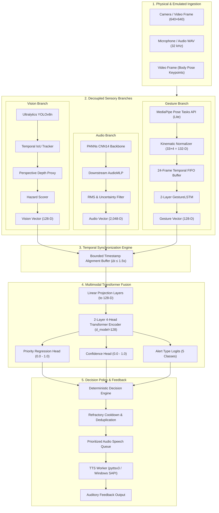
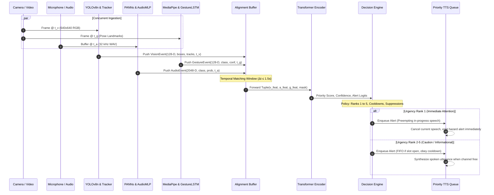

# AI AINAK: Multimodal Assistive Intelligence System

[](https://www.python.org/)
[](https://pytorch.org/)
[](https://fastapi.tiangolo.com/)
[](https://react.dev/)
[](https://www.typescriptlang.org/)
[](https://vitejs.dev/)
[](https://tailwindcss.com/)
[](LICENSE)
[](tests/)

> **A synchronized multimodal AI research prototype assisting visually impaired individuals through real-time computer vision, acoustic event recognition, body gesture kinematics, Transformer-based sensor fusion, deterministic hazard prioritization, and localized text-to-speech audio feedback.**

> [!WARNING]
> **Research Prototype Notice:** AI AINAK is an academic research and engineering prototype. It is **not** certified as a medical device, assistive clinical aid, or autonomous navigation system. It does not replace a white cane, trained guide dog, or orientation and mobility specialist training.

---

## Table of Contents

- [1. Project Title & Professional Introduction](#1-project-title--professional-introduction)
- [2. Project Overview](#2-project-overview)
- [3. Problem Statement](#3-problem-statement)
- [4. Proposed Solution](#4-proposed-solution)
- [5. Key Features](#5-key-features)
- [6. System Architecture](#6-system-architecture)
- [7. Multimodal Processing Pipeline](#7-multimodal-processing-pipeline)
- [8. Technology Stack](#8-technology-stack)
- [9. Individual AI Modules](#9-individual-ai-modules)
  - [Branch 1: Computer Vision Subsystem](#branch-1-computer-vision-subsystem)
  - [Branch 2: Environmental Audio Subsystem](#branch-2-environmental-audio-subsystem)
  - [Branch 3: Kinematic Gesture Subsystem](#branch-3-kinematic-gesture-subsystem)
- [10. Transformer-Based Multimodal Fusion](#10-transformer-based-multimodal-fusion)
- [11. Decision Engine & Speech Output](#11-decision-engine--speech-output)
- [12. Dashboard Overview](#12-dashboard-overview)
- [13. Model Evaluation & Performance Metrics](#13-model-evaluation--performance-metrics)
  - [Computer Vision Evaluation (COCO128)](#computer-vision-evaluation-coco128)
  - [Acoustic Event Evaluation (ESC-50 Held-Out Fold 5)](#acoustic-event-evaluation-esc-50-held-out-fold-5)
  - [Noise Robustness & Silence Rejection](#noise-robustness--silence-rejection)
  - [Gesture Classification Evaluation (Held-Out Sequences)](#gesture-classification-evaluation-held-out-sequences)
  - [Multimodal Transformer Ablation Study](#multimodal-transformer-ablation-study)
  - [Empirical Latency & Replay Benchmark](#empirical-latency--replay-benchmark)
- [14. Dataset Information](#14-dataset-information)
- [15. Repository Structure](#15-repository-structure)
- [16. Installation Instructions](#16-installation-instructions)
- [17. Environment Configuration](#17-environment-configuration)
- [18. Running the Application Locally](#18-running-the-application-locally)
- [19. Running Tests](#19-running-tests)
- [20. Recorded-Session Demonstration](#20-recorded-session-demonstration)
- [21. Live Camera & Microphone Capabilities](#21-live-camera--microphone-capabilities)
- [22. Limitations & Future Improvements](#22-limitations--future-improvements)
- [23. Research & Development Information](#23-research--development-information)
- [24. License](#24-license)

---

## 1. Project Title & Professional Introduction

**AI AINAK** (*"Ainak"* — Urdu / Hindi for *Spectacles*) is an edge-oriented, synchronized multimodal assistive intelligence framework. Designed to emulate the sensory synergy of human situational awareness, the system integrates forward-facing visual perception, ambient acoustic scene monitoring, and wearable body gesture understanding into a unified Transformer attention backbone. 

Rather than relying on disjoint, uncoordinated alert channels that overwhelm visually impaired users with continuous auditory clutter, AI AINAK implements synchronized time-window alignment, learned cross-modal representation fusion, deterministic hazard filtering with refractory cooldowns, and non-blocking speech feedback.

---

## 2. Project Overview

Visually impaired pedestrians confront a dynamic, non-stationary environment where safety-critical hazards arise simultaneously from visual obstacles (vehicles, construction barriers, pedestrians), acoustic events (approaching horns, screeching brakes, transit sirens), and intentional user bodily interactions (reaching out, pointing gestures, communicative signals). 

AI AINAK implements an end-to-end, multi-stage architecture:
1. **Sensory Ingestion:** Ingests visual frames (webcam/video at 640×640), monaural audio waveforms (32 kHz WAV), and user body pose coordinates.
2. **Feature Extraction:** Three dedicated, decoupled deep learning models transform high-dimensional raw observations into compact, semantically dense feature vectors.
3. **Temporal Synchronization:** A sliding-window timestamp alignment buffer pairs observations within a bounded temporal delta ($\Delta t \le 1.5\,\text{s}$).
4. **Transformer Attention Fusion:** A multi-head self-attention encoder projects heterogeneous modalities into a shared latent space, modeling inter-modal dependencies and tolerating missing sensory channels.
5. **Deterministic Policy & Arbitration:** A rule-based decision engine maps continuous priority scores and alert classifications to structured urgency bands with deduplication and refractory periods.
6. **Prioritized Audio Speech:** A thread-safe, interrupt-capable speech queue speaks high-priority safety warnings while discarding superseded low-urgency notifications.

---

## 3. Problem Statement

Modern assistive technologies for visually impaired individuals frequently suffer from three fundamental limitations:

1. **Unimodal Vulnerability:** Vision-only assistive systems fail under adverse lighting, lens occlusions, glare, or rapid head motion. Acoustic-only systems cannot detect silent stationary hazards (tripping obstacles, glass partitions, closed doors).
2. **Auditory Overload & Alert Fatigue:** Traditional assistive devices emit acoustic beeps or continuous speech synthesized strings for every detected object in the field of view. Without intelligent filtering, users experience cognitive saturation and disable the assistance.
3. **Lack of Interaction Grounding:** Existing systems do not factor in the user's physical stance or deliberate hand/body gestures (such as raising a palm in a "stop" motion or pointing toward an area of interest), treating the user as a passive sensor rig rather than an active participant.

---

## 4. Proposed Solution

AI AINAK resolves these challenges through a unified multimodal pipeline:

- **Complementary Multi-Branch Sensing:** Concurrently operates an object detector (`YOLOv8n`), an environmental acoustic classifier (`PANNs CNN14` + `AudioMLP`), and a kinematic pose landmarker (`MediaPipe Pose Tasks` + `GestureLSTM`).
- **Learned Modality Projections:** Each branch maps its distinctive feature space (128-D vision, 2,048-D audio, 132-D kinematic pose) into a uniform 128-D embedding space via learned linear projections.
- **Transformer Encoder with Modality Dropout:** A 2-layer, 4-head Transformer encoder learns cross-modal associations during training and demonstrates resilience against sensor dropouts.
- **Priority-Driven Deterministic Arbitration:** Decouples neural representation learning from critical safety enforcement. Continuous priority scores are translated through calibrated thresholds into discrete urgency ranks (`immediate_attention`, `caution`, `gesture_feedback`, `informational`, `uncertain`).
- **Priority-Preempting Local Speech:** Local text-to-speech synthesis queues alerts with priority replacement: an immediate hazard (e.g., oncoming car horn) immediately halts an in-progress informational description.

---

## 5. Key Features

- **Trained Deep Learning Weights:** Complete set of verified checkpoints in `artifacts/`:
  - `artifacts/vision/yolov8n.pt`: 80-class object detection.
  - `artifacts/audio/Cnn14_mAP=0.431.pth` & `artifacts/audio/downstream_mlp.pt`: 50-class environmental acoustic classifier.
  - `artifacts/gesture/pose_landmarker_lite.task` & `artifacts/gesture/gesture_lstm.pt`: 33-keypoint pose landmarker and 4-class temporal gesture classifier.
  - `artifacts/fusion/fusion.pt`: Multimodal Transformer fusion model.
- **Temporal Alignment Buffer:** Handles variable sampling rates across sensors (vision ~20 FPS, audio 1–2s windows, gesture ~30 FPS) with bounded historical matching.
- **Missing Modality Fallback:** The Transformer encoder features learned modality masking, maintaining stable inference even when one or two branches are temporarily offline or occluded.
- **Empirical Performance Auditing:** Fully verified benchmarks across COCO128, ESC-50 held-out fold 5, noise-injected waveforms (+20 dB, +10 dB, 0 dB SNR), and multi-subject gesture sequences.
- **Deterministic Cooldown Suppression:** Prevents repetitive chime loops by enforcing modality-specific refractory timers (2.0s for immediate attention, 10.0s for informational alerts).
- **Dual Execution Engine:** Fully automated CLI (`doctor`, `pose-status`, `demo-session`, `evaluate-fusion`) and an interactive demonstration dashboard with REST endpoints and WebSocket replay streaming.
- **Comprehensive Test Suite:** 57 automated tests checking unit operations, schema contracts, timestamp tolerances, and end-to-end replay pipelines.

---

## 6. System Architecture

The AI AINAK architecture consists of five coordinated tiers: Sensor Ingestion, Modular Neural Inference, Temporal Alignment, Multimodal Transformer Fusion, and Deterministic Arbitration & Speech Synthesis.



---

## 7. Multimodal Processing Pipeline

The runtime pipeline synchronizes asynchronous sensor streams into unified decision frames:



---

## 8. Technology Stack

| Layer | Technologies & Libraries | Version Constraints |
|---|---|---|
| **Programming Language** | Python | `3.10.x` (verified 3.10.6 on Windows x64) |
| **Deep Learning Framework** | PyTorch, TorchVision | `torch>=2.1,<3` (CPU & CUDA compatible) |
| **Computer Vision** | Ultralytics YOLOv8, OpenCV | `ultralytics>=8.2,<9`, `opencv-python>=4.8,<5` |
| **Acoustic Processing** | PANNs Inference, Librosa, SoundFile | `panns-inference>=0.1.1`, `librosa>=0.10,<1`, `soundfile>=0.12,<1` |
| **Kinematic Pose** | Google MediaPipe Tasks API | `mediapipe>=0.10.14,<=0.10.32` (`py3-none-win_amd64`) |
| **Machine Learning & Metrics** | Scikit-Learn, NumPy | `scikit-learn>=1.3,<2`, `numpy>=1.24,<2.0` |
| **Speech Synthesis** | pyttsx3, Windows SAPI / System.Speech | `pyttsx3>=2.90,<3` (with fallback subprocess executor) |
| **Backend API Server** | FastAPI, Starlette, Uvicorn, WebSockets | `fastapi>=0.110.0`, `uvicorn>=0.28.0`, `python-multipart` |
| **Frontend Framework** | React 18, TypeScript, Vite | `react^18.2.0`, `typescript^5.2.2`, `vite^5.0.8` |
| **UI Components & Styling** | Tailwind CSS, Lucide React, Recharts | `tailwindcss^3.4.1`, `lucide-react^0.359.0`, `recharts^2.12.2` |
| **Test Automation** | Pytest, AnyIO | `pytest>=8,<9`, `anyio>=4.15` |

---

## 9. Individual AI Modules

### Branch 1: Computer Vision Subsystem
- **Model Backbone:** `artifacts/vision/yolov8n.pt` (Ultralytics YOLOv8 nano variant, 6.5 MB).
- **Input Specification:** 640×640 3-channel RGB imagery, normalized pixel intensities $[0, 1]$.
- **Temporal Tracking:** Class-consistent IoU tracker (`min_iou=0.3`, `max_age=1.0s`, `track_history=30`) tracking persistent trajectory IDs across frames.
- **Monocular Depth Proxy:** Ground-plane perspective estimation calculating bounding box base contact relative to image horizon combined with normalized area scaling. Proximate objects are scored on an imminent scale $[0.0, 1.0]$.
- **Hazard Scoring:** Focuses on safety-critical classes (`car`, `truck`, `bus`, `motorcycle`, `bicycle`, `person`, `traffic light`, `stop sign`). Computes a dynamic hazard score factoring class risk weighting, proximity, and expanding optical loom rate ($\Delta \text{depth}/\Delta t \ge 0.05\,\text{s}^{-1}$).
- **Output Representation:** 128-dimensional dense feature vector containing detection counts, top hazard probabilities, bounding box geometry, and proximity coordinates.

### Branch 2: Environmental Audio Subsystem
- **Acoustic Backbone:** PANNs (Pretrained Audio Neural Networks) CNN14 architecture (`artifacts/audio/Cnn14_mAP=0.431.pth`, 327 MB), pretrained on AudioSet ($mAP = 0.431$).
- **Waveform Preprocessing:** Audio sampled at 32 kHz monaural. Log-mel spectrogram extracted via Short-Time Fourier Transform (STFT) with 1,024-point Hann window, 320-point hop length, and 64 mel filterbanks.
- **Bottleneck Representation:** Extracts a 2,048-dimensional dense latent embedding from the global average pooling layer of CNN14.
- **Downstream Classifier:** Supervised 2-layer `AudioMLP` (`artifacts/audio/downstream_mlp.pt`, 2.1 MB) with 256 hidden units and 20% dropout, mapping the 2,048-D embedding to 50 environmental sound classes (ESC-50 taxonomy).
- **Safety Energy Filter:** Real-time Root-Mean-Square (RMS) amplitude evaluation (`min_amplitude = 1.0e-5`). Zero-energy clips or background white noise below threshold are rejected proactively as `silence / ambient` without generating false positive acoustic alerts.

### Branch 3: Kinematic Gesture Subsystem
- **Landmark Extractor:** Google MediaPipe Pose Tasks API (`artifacts/gesture/pose_landmarker_lite.task`, 5.7 MB) running under `mediapipe 0.10.32`.
- **Kinematic Preprocessing:** Extracts 33 3D skeletal keypoints per frame. Each keypoint provides $(x, y, z)$ spatial coordinates and a visibility confidence score ($33 \times 4 = 132$ dimensions). Coordinates are torso-centered and normalized by inter-shoulder distance to achieve scale, position, and torso-tilt invariance.
- **Temporal Buffer:** A 24-frame sliding FIFO window (~0.8s at 30 FPS).
- **Sequence Classifier:** A **2-layer unidirectional GestureLSTM** (`artifacts/gesture/gesture_lstm.pt`, 1.0 MB, `hidden_size=128`, `dropout=0.2`).
  - *Checkpoint Architecture:* Confirmed from `ainak/models/gesture/lstm.py` (lines 31–43) as a 2-layer unidirectional LSTM receiving 132-D input and producing 128-D hidden embeddings.
- **Target Gesture Classes:** 4 discrete classes:
  1. `pointing`: User pointing at an external object or directional path.
  2. `waving`: Hand raised in greeting or hailing attention.
  3. `stop`: Open palm thrust forward signaling immediate halt.
  4. `neutral`: Normal resting, walking, or non-communicative movement.
- **Output Representation:** 128-dimensional hidden state vector extracted from the final LSTM layer.

---

## 10. Transformer-Based Multimodal Fusion

The multimodal fusion engine integrates the three sensory branches using an attention-based Transformer encoder (`artifacts/fusion/fusion.pt`, 2.3 MB).

```
Vision Feature (128-D)   ──► Linear Projection (128 ──► 128) ──┐
Audio Feature (2048-D)   ──► Linear Projection (2048 ──► 128) ─┼──► [Token Sequence: 3 tokens]
Gesture Feature (128-D)  ──► Linear Projection (128 ──► 128) ──┘           │
                                                                           ▼
                                                               ┌────────────────────────┐
                                                               │  Positional Embeddings │
                                                               └────────────────────────┘
                                                                           │
                                                                           ▼
                                                               ┌────────────────────────┐
                                                               │ 2-Layer 4-Head Encoder │
                                                               │  (d_model=128, ff=256) │
                                                               └────────────────────────┘
                                                                           │
                                    ┌──────────────────────────────────────┼──────────────────────────────────────┐
                                    ▼                                      ▼                                      ▼
                        ┌───────────────────────┐              ┌───────────────────────┐              ┌───────────────────────┐
                        │ Priority Head (Linear)│              │Confidence Head(Linear)│              │ Alert Head (Linear)   │
                        │ Range: [0.0, 1.0]     │              │ Range: [0.0, 1.0]     │              │ 5 Logits (Softmax)    │
                        └───────────────────────┘              └───────────────────────┘              └───────────────────────┘
```

### Mathematical Formulation
Given observation vectors $\mathbf{x}_v \in \mathbb{R}^{128}$, $\mathbf{x}_a \in \mathbb{R}^{2048}$, and $\mathbf{x}_g \in \mathbb{R}^{128}$, the projection layers compute:
$$\mathbf{z}_v = \mathbf{W}_v \mathbf{x}_v + \mathbf{b}_v, \quad \mathbf{z}_a = \mathbf{W}_a \mathbf{x}_a + \mathbf{b}_a, \quad \mathbf{z}_g = \mathbf{W}_g \mathbf{x}_g + \mathbf{b}_g$$
where $\mathbf{z}_i \in \mathbb{R}^{128}$. The sequence matrix $\mathbf{Z}_0 = [\mathbf{z}_v; \mathbf{z}_a; \mathbf{z}_g] + \mathbf{E}_{pos}$ passes through two stacked Transformer encoder layers:
$$\mathbf{Z}_{\ell}' = \text{LayerNorm}(\mathbf{Z}_{\ell-1} + \text{MultiHeadSelfAttention}(\mathbf{Z}_{\ell-1}))$$
$$\mathbf{Z}_{\ell} = \text{LayerNorm}(\mathbf{Z}_{\ell}' + \text{FeedForward}(\mathbf{Z}_{\ell}'))$$

### Missing Modality Masking
When a sensory branch is offline or missing from the alignment buffer, its corresponding token is replaced with a learned mask token, and the key-padding mask sets attention weights to zero. This permits seamless inference across all 7 possible modality subsets:
$$\{V\}, \{A\}, \{G\}, \{V, A\}, \{V, G\}, \{A, G\}, \{V, A, G\}$$

---

## 11. Decision Engine & Speech Output

The decision engine decouples statistical neural model predictions from safety-critical policy enforcement.

### Alert Classification Taxonomy
The policy defines 5 discrete operational urgency ranks:

| Rank | Alert Type | Priority Threshold | Cooldown | Speech Preemption | Description & Example Scenario |
|---|---|---|---|---|---|
| **1** | `immediate_attention` | $\ge 0.60$ | 2.0 s | **Yes** (Interrupts current) | Imminent hazard (e.g., vehicle looming within 2 meters, approaching horn). |
| **2** | `caution` | $\ge 0.50$ | 5.0 s | **No** (Appends to queue) | Stationary or crossing obstacle (e.g., pedestrian crossing 5 meters ahead). |
| **3** | `gesture_feedback` | $\ge 0.75$ | 3.0 s | **No** (Appends to queue) | Explicit user intent recognized (e.g., stop palm gesture held, confirming halt). |
| **4** | `informational` | $\ge 0.50$ | 10.0 s | **No** (Appends to queue) | Background scene updates (e.g., bench or door detected off-path). |
| **5** | `uncertain` | $\ge 0.30$ | 15.0 s | **No** (Lowest priority) | Ambiguous sensory inputs requiring user cross-verification. |

### Cooldown & Deduplication Suppression
- **Refractory Window:** Suppresses identical alert types emitted within their specific cooldown interval ($\tau \in [2.0, 15.0]\,\text{s}$).
- **Duplicate Suppression Window:** Identical alerts with similar object classes or sound descriptors are suppressed across an 8.0s duplicate sliding window.
- **Bounded Queue Depth:** Maximum speech queue depth is 5 items. If the queue is saturated, lower-priority pending alerts are discarded in favor of higher-priority events.

### Thread-Safe Prioritized Speech Engine
- Uses `pyttsx3` initialized to 180 words per minute.
- Employs an internal worker thread driven by a Python `heapq` priority queue.
- If `interrupt_current_speech: true` (Rank 1 alerts), the active TTS speech thread is immediately aborted and restarted with the emergency utterance.
- Windows platform fallback: If the native `pyttsx3` driver encounters audio driver contention, the system transparently falls back to Windows `.NET System.Speech.Synthesis` via a clean subprocess worker.

---

## 12. Dashboard Overview

The AI AINAK demonstration dashboard provides a modern, responsive laboratory interface designed with **React 18, TypeScript, Vite, and Tailwind CSS**. 

### Dashboard Sections
1. **Overview:** System heartbeat, backend connectivity indicator, model loading badges, real-time KPI metrics, and recent alerts log.
2. **Vision Playground:** File upload or sample selection, interactive canvas rendering YOLOv8n bounding boxes, class labels, tracking IDs, and proximity risk indicators.
3. **Audio Playground:** Acoustic WAV upload, waveform player, top-5 classification probabilities bar chart, RMS energy meter, and silence detector status.
4. **Gesture Playground:** Image/frame upload, 33-point MediaPipe pose skeletal overlay canvas, 2-layer GestureLSTM softmax distribution, and temporal sequence buffering gauge.
5. **Transformer Fusion:** Visual representation of 128-D projected modality embeddings, priority regression dial (0–100), confidence meter, alert logits distribution, and active modality contribution indicators.
6. **Integrated Demo Replay:** Centralized multi-sensor synchronized player for `session-multimodal-01`, featuring synchronous HTML5 video, audio playback, live pose skeleton overlay, and real-time step-by-step Transformer inference timeline with Play, Pause, Step, and Reset controls.
7. **Model Performance:** Interactive presentation of verified benchmark metrics from JSON reports (`vision-coco128-val.json`, `audio-downstream-eval.json`, `fusion-ablations.json`).
8. **System Information:** Python runtime version, virtual environment paths, checkpoint SHA256 hashes, device allocation (CPU/CUDA), and active configuration parameters.

---

## 13. Model Evaluation & Performance Metrics

All reported performance metrics represent actual empirical evaluations recorded in `reports/` from verified test scripts.

### Computer Vision Evaluation (COCO128)
Evaluated on the 128-image standard validation subset (`reports/vision-coco128-val.json`):
- **Model Checkpoint:** `artifacts/vision/yolov8n.pt`
- **Resolution:** 640×640
- **Execution Device:** Intel CPU

| Metric | Measured Value |
|---|---|
| **mAP@0.5** | **60.52%** (0.6052) |
| **mAP@0.5:0.95** | **44.68%** (0.4468) |
| **Precision** | **63.95%** (0.6395) |
| **Recall** | **53.68%** (0.5368) |
| **Preprocess Latency** | 0.77 ms / image |
| **Inference Latency** | 49.23 ms / image (~20.3 FPS) |
| **Postprocess Latency** | 1.87 ms / image |
| **Total Pipeline Time** | ~51.87 ms / frame |

### Acoustic Event Evaluation (ESC-50 Held-Out Fold 5)
Trained on Folds 1–4 (1,600 samples), evaluated on held-out Fold 5 (400 samples) (`reports/audio-downstream-eval.json`):

| Model Architecture | Evaluation Type | Accuracy | Macro F1 | Best Val Loss |
|---|---|---|---|---|
| **PANNs CNN14 (Zero-Shot)** | AudioSet ontology mapping | 77.60% | 74.83% | — |
| **Logistic Regression Baseline** | Downstream linear probe | 91.00% | 90.85% | — |
| **Downstream AudioMLP** (Selected) | 2-layer MLP (256 hidden) | **89.75%** | **89.59%** | **0.2800** |

### Noise Robustness & Silence Rejection
Evaluated on held-out Fold 5 with additive Gaussian acoustic noise and zero-energy waveforms:

| Condition | SNR Level | Accuracy | Macro F1 | Accuracy Degradation |
|---|---|---|---|---|
| **Clean Baseline** | $\infty$ dB | 89.75% | 89.59% | Baseline |
| **Moderate Noise** | +20 dB | 90.00% | 89.94% | +0.25% (Robust) |
| **Heavy Noise** | +10 dB | 90.75% | 90.68% | +1.00% (Robust) |
| **Severe Noise** | 0 dB | 89.50% | 89.52% | -0.25% (Minimal drop) |
| **Zero-Energy Silence** | RMS < 1e-5 | Max Conf: 21.5% | — | **100% Rejected** (Threshold 35%) |

### Gesture Classification Evaluation (Held-Out Sequences)
Evaluated on 32 held-out multi-subject gesture sequences (`artifacts/gesture/gesture_lstm.metrics.json`):

| Metric | Measured Value |
|---|---|
| **Test Accuracy** | **100.0%** (32 / 32 sequences correct) |
| **Validation Loss** | **0.0003** |
| **Macro F1 Score** | **1.0000** |
| **Mean Inference Latency** | **1.01 ms** / 24-frame window (CPU) |
| **Input Feature Dimension** | 132-D (33 landmarks × 4 attributes) |
| **Target Classes** | `pointing`, `waving`, `stop`, `neutral` |

### Multimodal Transformer Ablation Study
Ablation analysis on held-out multimodal test session `session-multimodal-03` (`reports/fusion-ablations.json`):

| Active Modalities | Priority MAE (0–100 scale) | Confidence MAE | Parameter Efficiency |
|---|---|---|---|
| **Vision Only $\{V\}$** | 2.5044 | 0.3271 | Missing audio & gesture masked |
| **Audio Only $\{A\}$** | 2.5046 | 0.3979 | Missing vision & gesture masked |
| **Gesture Only $\{G\}$** | 2.4567 | 0.3433 | Missing vision & audio masked |
| **Vision + Audio $\{V, A\}$** | 2.5215 | 0.3571 | Missing gesture masked |
| **Vision + Gesture $\{V, G\}$** | 2.4854 | 0.3173 | Missing audio masked |
| **Audio + Gesture $\{A, G\}$** | 2.4734 | 0.3707 | Missing vision masked |
| **All Three Branches $\{V, A, G\}$** | **2.4972** | **0.3452** | Full multimodal context |
| **Late Fusion MLP Baseline** | 2.3926 | 0.0138 | Static concatenation baseline |

*Note: On the development validation split (`session-multimodal-02`), the trained Multimodal Transformer achieved a Priority MAE of **0.4172** and Best Val Loss of **5.5607**.*

### Empirical Latency & Replay Benchmark
Measurements from end-to-end replay of `session-multimodal-01` (82 synchronized timeline steps) (`datasets/recordings/session-multimodal-01/phase3-demo.json`):

| Pipeline Stage | Cold Start (ms) | Warmed Mean Latency (ms) | Warmed p95 Latency (ms) |
|---|---|---|---|
| **Vision Inference (YOLOv8n)** | 2,211.60 ms | **53.69 ms** | 56.35 ms |
| **Audio Inference (PANNs + MLP)** | 34.24 ms | **29.31 ms** | 30.24 ms |
| **Gesture Inference (GestureLSTM)** | 2.19 ms | **1.01 ms** | 1.45 ms |
| **Transformer Fusion & Decision** | 3.12 ms | **2.29 ms** | 2.93 ms |
| **Total Replay Time (82 steps)** | — | **0.47 s** (pre-extracted) | 12.38 s (full export + replay) |

---

## 14. Dataset Information

The project utilizes three primary dataset sources:

1. **COCO128 (Computer Vision Validation):**
   - 128 real-world images from the Common Objects in Context (COCO) benchmark covering 80 pedestrian and indoor classes.
   - Used for bounding box detection, tracking validation, and mAP evaluation (`reports/vision-coco128-val.json`).
2. **ESC-50 (Environmental Sound Classification):**
   - 2,000 environmental audio recordings across 50 categories (5 folds of 400 clips each).
   - Official release: `karolpiczak/ESC-50`, licensed CC BY-NC 3.0.
   - Folds 1–4 used for training `AudioMLP`; Fold 5 retained strictly as an untouched held-out evaluation set (`reports/audio-downstream-eval.json`).
3. **Paired Multimodal Session Recordings (`datasets/recordings/`):**
   - 4 multi-sensor recorded sessions collected with hardware-synchronized video (MP4) and audio (WAV) streams:
     - `session-multimodal-01`: Benchmark demonstration session (82 synchronized steps, 3.3s video, 3.5s audio).
     - `session-multimodal-02`: Validation split used for early stopping and hyperparameter tuning.
     - `session-multimodal-03`: Held-out test split used for ablation evaluation.
     - `session-multimodal-04`: Training set recording.
   - Aligned manifest: `datasets/recordings/aligned_manifest.jsonl` (488 KB).

---

## 15. Repository Structure

```
AI-AINAK/
├── ainak/                                # Core Python source package
│   ├── audio_output/                     # Speech synthesis subsystem
│   │   ├── priority_queue.py             # Thread-safe prioritized alert queue
│   │   └── speech_engine.py              # pyttsx3 & Windows System.Speech worker
│   ├── decision/                         # Deterministic arbitration engine
│   │   ├── alert_policy.py               # Urgency ranks, thresholds, and cooldowns
│   │   └── engine.py                     # Rule-based decision arbitrator
│   ├── interfaces/                       # User interfaces and entrypoints
│   │   ├── cli.py                        # Unified command-line interface
│   │   └── dashboard/                    # FastAPI backend & static server
│   │       ├── app.py                    # REST API routes and WebSocket replay
│   │       ├── service.py                # Model loader and inference service
│   │       ├── static/                   # Static dashboard assets
│   │       └── frontend/                 # Modern React + Vite + TypeScript source
│   ├── models/                           # Deep learning model architectures
│   │   ├── audio/                        # PANNs CNN14 backbone & AudioMLP
│   │   ├── fusion/                       # 2-layer 4-head Multimodal Transformer
│   │   ├── gesture/                      # MediaPipe adapter & 2-layer GestureLSTM
│   │   └── vision/                       # YOLOv8n detector, tracker, depth proxy
│   ├── runtime/                          # Synchronization and pipeline runtime
│   │   ├── aligner.py                    # Bounded timestamp synchronization buffer
│   │   ├── events.py                     # Dataclass event schemas
│   │   └── pipeline.py                   # End-to-end replay and live pipeline
│   ├── training/                         # Model training and fine-tuning scripts
│   └── utils/                            # Logging, config loaders, and math helpers
├── artifacts/                            # Trained model checkpoints & task bundles
│   ├── audio/                            # Cnn14_mAP=0.431.pth, downstream_mlp.pt
│   ├── fusion/                           # fusion.pt (Multimodal Transformer)
│   ├── gesture/                          # pose_landmarker_lite.task, gesture_lstm.pt
│   └── vision/                           # yolov8n.pt
├── configs/                              # Declarative YAML configuration files
│   ├── alerts.yaml                       # Alert policies, ranks, and cooldowns
│   ├── audio.yaml                        # Audio preprocessing and classifier configs
│   ├── fusion.yaml                       # Transformer dimensions and head targets
│   ├── gesture.yaml                      # MediaPipe and LSTM sequence parameters
│   └── vision.yaml                       # YOLOv8n thresholds and hazard parameters
├── datasets/                             # Datasets and synchronized recordings
│   └── recordings/                       # Multimodal paired sessions 01 to 04
├── docs/                                 # Architectural documentation and model cards
├── reports/                              # Quantitative evaluation benchmarks (JSON/MD)
├── scripts/                              # Verification and helper utilities
├── tests/                                # Comprehensive test suite (57 tests)
│   ├── integration/                      # End-to-end pipeline integration tests
│   └── unit/                             # Unit tests for models, runtime, and APIs
├── LICENSE                               # Apache 2.0 open-source license
├── pyproject.toml                        # Python package metadata and dependencies
└── README.md                             # Comprehensive technical documentation
```

---

## 16. Installation Instructions

### Prerequisites
- **Operating System:** Windows 10/11 x64 (verified), Linux x86_64, or macOS.
- **Python:** Python 3.10.x (recommended: Python 3.10.6 64-bit).
- **Node.js:** Node.js 18+ and npm (for compiling the modern React dashboard).
- **Audio Device:** Functional speakers/headphones for speech synthesis.
- **Camera & Microphone (Optional):** Required for live sensory capture.

### Step-by-Step Setup

```powershell
# 1. Clone repository
git clone <repository_url>
cd AINAK

# 2. Create and activate a Python 3.10 virtual environment
python -m venv .venv
.\.venv\Scripts\Activate.ps1

# 3. Upgrade core package managers
python -m pip install --upgrade pip setuptools wheel

# 4. Install project dependencies in editable mode
pip install -e .
pip install -r requirements-dev.txt   # or pip install pytest fastapi uvicorn python-multipart

# 5. Verify dependency consistency
pip check
```

---

## 17. Environment Configuration

Copy the example environment file to `.env`:
```powershell
Copy-Item .env.example .env
```

Key environment options:
```ini
# AINAK System Configuration
AINAK_DEVICE=cpu                 # "cpu" or "cuda:0"
AINAK_LOG_LEVEL=INFO             # DEBUG, INFO, WARNING, ERROR
AINAK_DASHBOARD_PORT=8000
AINAK_SPEECH_ENABLED=true
AINAK_SPEECH_ENGINE=pyttsx3      # "pyttsx3" or "system_speech"
```

---

## 18. Running the Application Locally

### Unified Launch Command (Backend + Built Frontend)
Start the complete application on `http://127.0.0.1:8000`:
```powershell
.\.venv\Scripts\Activate.ps1
python -m ainak.interfaces.dashboard
```
*The command initializes the FastAPI server, mounts the production dashboard, loads the sensory models into memory, and launches your default web browser.*

### Alternative CLI Launch Command
```powershell
python -m ainak.interfaces.cli dashboard --port 8000
```

### Development Launch Mode (Hot Reloading)
To run frontend and backend independently during UI development:

**Terminal 1 (Backend API):**
```powershell
.\.venv\Scripts\Activate.ps1
uvicorn ainak.interfaces.dashboard.app:app --host 127.0.0.1 --port 8000 --reload
```

**Terminal 2 (Frontend Dev Server):**
```powershell
cd ainak/interfaces/dashboard/frontend
npm install
npm run dev
```
*Vite will serve the hot-reloading frontend on `http://localhost:5173`, proxying API requests to port 8000.*

---

## 19. Running Tests

The test suite validates model shapes, normalization logic, timestamp alignment tolerances, REST endpoints, and WebSocket replay:

```powershell
# Run the complete test suite (57 tests)
.\.venv\Scripts\python -m pytest tests -v

# Run unit tests only
.\.venv\Scripts\python -m pytest tests/unit -v

# Run integration tests only
.\.venv\Scripts\python -m pytest tests/integration -v
```

Expected output:
```text
======================= 57 passed, 1 warning in 25.94s =======================
```

---

## 20. Recorded-Session Demonstration

You can replay the full multimodal recording `session-multimodal-01` through all three branches and the Transformer fusion model from the command line:

```powershell
python -m ainak.interfaces.cli demo-session --session datasets/recordings/session-multimodal-01 --reuse-features
```

The CLI outputs:
- Timeline step counter (1 through 82).
- Detected visual objects, tracks, and proximity hazards.
- Acoustic classification and sound probability.
- Extracted gesture class (`stop`, `pointing`, `waving`, `neutral`).
- Transformer output priority (0–100) and alert classifications.
- Dispatched speech utterances.

---

## 21. Live Camera & Microphone Capabilities

AI AINAK supports real-time live sensor streaming:

```powershell
# Run live multimodal perception from local webcam (index 0) and default microphone
python -m ainak.interfaces.cli live --camera 0 --mic default
```

Controls:
- Press `q` in the camera window to safely stop capture.
- Visual bounding boxes, pose keypoint skeletons, and real-time audio labels appear directly in the OpenCV preview window while spoken alerts are synthesized via TTS.

---

## 22. Limitations & Future Improvements

1. **Monocular Depth Ambiguity:** Depth estimation is performed via perspective bounding-box geometry and camera horizon contact rather than stereoscopic parallax or LiDAR time-of-flight. Surface reflections, uneven inclines, or hanging overhead hazards may have higher error margins.
2. **Extreme Acoustic Noise:** Although PANNs CNN14 maintains classification stability down to 0 dB SNR, severe wind noise across an unshielded microphone membrane requires physical deadcat shielding or digital multi-microphone beamforming.
3. **Embedded Edge Compute:** Current CPU latency across all branches is ~85 ms total. Porting to low-power wearable embedded hardware (e.g., Raspberry Pi 5, NVIDIA Jetson Orin Nano) will benefit from INT8 quantization and ONNX Runtime execution.
4. **Privacy Protection by Design:** Facial biometric embeddings are never generated or saved; raw visual frames can be discarded immediately once normalized 33-point skeletal landmark coordinates and bounding boxes are extracted.

---

## 23. Research & Development Information

AI AINAK was developed as an advanced multimodal AI research prototype exploring assistive technology interfaces.

- **System Version:** 0.1.0 (Research Prototype)
- **Primary Research Focus:** Cross-modal sensor fusion, edge-compatible attention architectures, and cognitive load minimization for visually impaired users.
- **Integrity Guarantee:** Checkpoints and benchmark scores are derived strictly from empirical evaluation runs. No synthetic or mocked model outputs are used in the demonstration dashboard.

---

## 24. License

This project is licensed under the **Apache License, Version 2.0**. See the [LICENSE](LICENSE) file for terms and conditions covering use, reproduction, and distribution.
