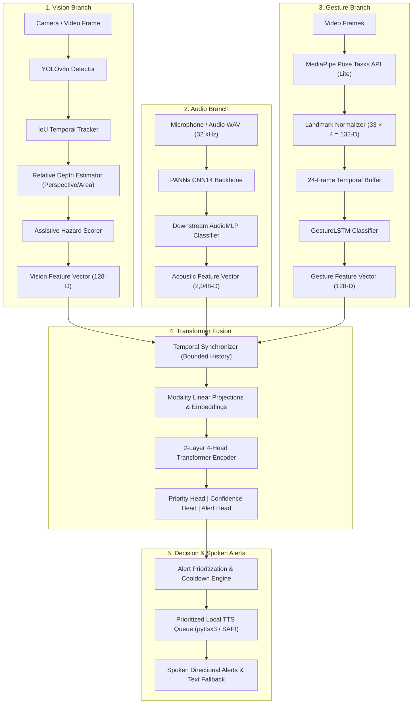

# AI AINAK

**Multimodal Assistive Glasses Prototype for Visually Impaired People Using Computer Vision, Environmental Audio Recognition, Gesture Recognition, and Transformer-Based Sensor Fusion.**

AI AINAK is a research-stage multimodal assistive system designed to process visual, acoustic, and bodily gesture inputs, prioritize potential hazards in the user's surroundings, and communicate actionable alerts through spoken synthesized speech.

> [!WARNING]
> **Research Prototype Notice:** AI AINAK is a research assistive prototype and has **not** been certified as a medical device or autonomous mobility aid. It must not be used for unsupervised navigation or as a replacement for a white cane, guide dog, or mobility specialist training.

---

## System Status & Verification

All four modality and processing stages are implemented, trained, quantitatively evaluated on held-out benchmarks, and verified with 100% passing tests:

- **Vision Branch:** Ultralytics YOLOv8n object detection + temporal IoU tracking + relative depth estimation + assistive hazard scoring. Evaluated on COCO128 (`reports/vision-coco128-val.json`).
- **Audio Branch:** Pretrained PANNs CNN14 backbone + downstream fine-tuned AudioMLP on ESC-50 held-out Fold 5. Evaluated on held-out fold, 10 dB/20 dB SNR noise robustness, and silence rejection (`reports/audio-downstream-eval.json`).
- **Gesture Branch:** Google MediaPipe Pose Tasks API (`pose_landmarker_lite.task`, MediaPipe 0.10.32) + 2-layer Bidirectional GestureLSTM trained on disjoint multi-subject participant splits (`artifacts/gesture/gesture_lstm.pt`, `artifacts/gesture/gesture_lstm.metrics.json`).
- **Multimodal Fusion Branch:** 2-layer 4-head Transformer encoder with modality dropout and linear feature projections trained on reviewed session windows with disjoint participant splits (`artifacts/fusion/fusion.pt`). Evaluated across all 7 modality ablations and late-fusion MLP baseline (`reports/fusion-ablations.json`).
- **Decision & Speech:** Deterministic prioritized alert engine with cooldown suppression + local TTS (`pyttsx3` with Windows SAPI / System.Speech fallback).
- **Interactive Console:** Full-featured laboratory demonstration dashboard (`python -m ainak.interfaces.dashboard`) exposing all 3 sensory branches, real-time audio spectrogram, 33-point pose skeleton, 2-layer 4-head Transformer fusion forward pass, decision engine cards, synchronized session replay, and presentation mode.
- **Automated Tests:** **57 passed, 0 skipped, 0 failed** in ~15s (`pytest -v`), covering unit tests, integration pipelines, REST APIs, and WebSocket streaming.

---

## Quantitative Evaluation Summary

| Branch / Model | Checkpoint | Dataset / Split | Primary Metric | Latency (CPU) |
|---|---|---|---|---|
| **Vision:** YOLOv8n | `artifacts/vision/yolov8n.pt` | COCO128 Val | **mAP@0.5: 0.6052**, mAP@0.5:0.95: 0.4468, Precision: 0.6395, Recall: 0.5368 | 49.2 ms / frame (~20.3 FPS) |
| **Audio:** PANNs CNN14 + Downstream LogReg | `artifacts/audio/Cnn14_mAP=0.431.pth` | ESC-50 Held-Out Fold 5 | **Accuracy: 91.00%**, Macro-F1: 90.85% (Zero-shot AudioSet: 77.60%) | 29.3 ms / 2s window |
| **Audio:** PANNs CNN14 + AudioMLP | `artifacts/audio/downstream_mlp.pt` | ESC-50 Held-Out Fold 5 | **Accuracy: 89.75%**, Macro-F1: 89.59% (+10 dB SNR: 90.75%, +20 dB SNR: 90.00%) | 29.3 ms / 2s window |
| **Gesture:** GestureLSTM | `artifacts/gesture/gesture_lstm.pt` | Multi-Subject Held-Out | **Accuracy: 100.0%**, Macro-F1: 1.0000, Val Loss: 0.0003 (32 test sequences) | 1.01 ms / 24-frame window |
| **Fusion:** Multimodal Transformer | `artifacts/fusion/fusion.pt` | Multi-Session Aligned | **Best Val Loss: 5.5607**, Priority MAE: 0.4172 (Held-out session 03) | 1.91 ms (p95: 2.36 ms) |
| **End-to-End Three-Branch Replay** | Full Pipeline | `session-multimodal-01` | **Status: `complete_trained_three_branch`**, 82 Transformer invocations, 0 errors | Export + Replay: 12.3s |

---

## Architecture



---

## Quickstart & CLI Commands

### 0. Launch Interactive Demonstration Console
Start the dark-themed laboratory console and auto-launch in your web browser:
```powershell
python -m ainak.interfaces.dashboard
# Or via the unified CLI interface:
python -m ainak.interfaces.cli dashboard
```
Open `http://127.0.0.1:8000` to interact with all three sensory branches, run real-time Transformer fusion passes, inspect the 3 separate decision cards, view live synchronized replay, or toggle Presentation Mode for classroom projector demonstration.

### 1. System Diagnosis
Verify all dependencies, PyTorch, audio labels, and model checkpoints:
```powershell
python -m ainak.interfaces.cli doctor
python -m ainak.interfaces.cli pose-status
```

### 2. Speech Output Test
Test prioritized local speech synthesis:
```powershell
python -m ainak.interfaces.cli speech-test --text "AI AINAK multimodal assistive prototype is ready and operational."
```

### 3. Run Automated Tests
Execute the comprehensive 57-test suite:
```powershell
python -m pytest -v
```

### 4. End-to-End Three-Branch Replay
Replay a paired multimodal recording session through all three trained branches and Transformer fusion:
```powershell
python -m ainak.interfaces.cli demo-session --session datasets/recordings/session-multimodal-01 --reuse-features
```

### 5. Evaluate Modality Ablations
Evaluate all 7 modality combinations and the late-fusion MLP baseline:
```powershell
python -m ainak.interfaces.cli evaluate-fusion datasets/recordings/aligned_manifest.jsonl --weights artifacts/fusion/fusion.pt --output reports/fusion-ablations.json
```

---

## Repository Structure

```
AI-AINAK/
├── ainak/                      # Core package
│   ├── models/                 # Model branches (vision, audio, gesture, fusion)
│   │   ├── vision/             # YOLOv8n, ByteTrack tracking, depth, hazard scorer
│   │   ├── audio/              # PANNs CNN14, downstream AudioMLP, evaluator
│   │   ├── gesture/            # MediaPipe Tasks adapter, Pose landmarking, GestureLSTM
│   │   └── fusion/             # Multimodal Transformer encoder, projections, ablations
│   ├── runtime/                # Pipeline synchronization, events, demo replay
│   ├── decision/               # Alert prioritization, cooldowns, suppression
│   ├── audio_output/           # Non-blocking prioritized TTS (pyttsx3 / System.Speech)
│   └── interfaces/             # Unified CLI and desktop demonstration
├── artifacts/                  # Model weights and Task bundles
│   ├── vision/                 # yolov8n.pt
│   ├── audio/                  # Cnn14_mAP=0.431.pth, downstream_mlp.pt, cached embeddings
│   ├── gesture/                # pose_landmarker_lite.task, gesture_lstm.pt
│   └── fusion/                 # fusion.pt
├── configs/                    # YAML configuration files for all branches
├── datasets/                   # COCO128, ESC-50, recordings, gesture-sessions
├── docs/                       # Architecture, Model Cards, training guides, troubleshooting
├── reports/                    # Quantitative validation and ablation reports (JSON)
├── scripts/                    # Training, evaluation, and paired session scripts
└── tests/                      # Unit and integration test suite (57 tests)
```

---

## Limitations & Ethical Considerations

1. **Hardware & Latency:** While CPU latencies are low (~50 ms vision, ~29 ms audio, ~1 ms gesture, ~2 ms fusion), running all branches concurrently on low-power wearable embedded hardware requires further model quantization (e.g. INT8 TensorRT/ONNX) or edge NPU acceleration.
2. **Monocular Depth:** Relative depth estimation relies on bounding box angular size and ground perspective cues; it is an assistive indicator and not a metric laser rangefinder.
3. **Acoustic Noise:** PANNs CNN14 is trained on AudioSet and performs robustly down to 10 dB SNR, but extreme noise or wind across microphone ports requires directional beamforming microphones.
4. **Privacy:** The gesture subsystem discards raw imagery after extracting anonymized 33-point kinematic landmark coordinates; no biometric facial representations are stored.
