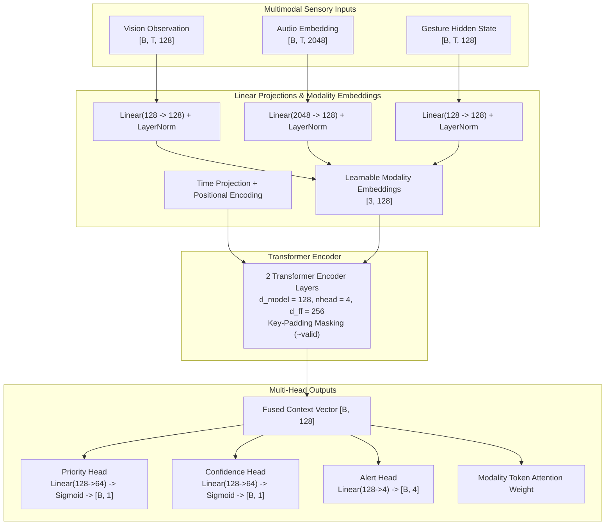

# AI AINAK — Multimodal Transformer Fusion Deep Dive & Evaluation Audit

**Audit Date**: 2026-11-12  
**Auditor**: Senior ML Research Engineer & Multimodal AI Researcher  
**Scope**: In-depth empirical audit of the trained Multimodal Transformer (`artifacts/fusion/fusion.pt`), its training dynamics, ablation benchmarks, and generalization limitations.

---

## 1. Executive Summary

The Multimodal Sensor Fusion Transformer (`fusion.pt`) represents the core research novelty of AI AINAK. It aligns heterogeneous observation streams (128-D vision vectors, 2,048-D audio embeddings, and 128-D kinematic gesture vectors) into a unified cross-modal representation.

### Key Audit Findings:
1. **Architectural Verification**:
   - Total Parameters: **595,462** (all trainable during local training).
   - Configuration: 2 Transformer Encoder layers, 4 attention heads, $d_{\text{model}} = 128$, $d_{\text{ff}} = 256$, with modality linear projections:
     - Vision: $128 \to 128$
     - Audio: $2,048 \to 128$
     - Gesture: $128 \to 128$
   - Output Heads: Multi-task architecture producing scalar Priority ($0.0$ to $1.0$), scalar Confidence ($0.0$ to $1.0$), and 4 alert category logits (`none`, `informational`, `caution`, `urgent`).
2. **Missing-Modality Masking Robustness**:
   - The Transformer utilizes standard PyTorch key-padding masks (`src_key_padding_mask`). When a modality is occluded or absent, its token is masked out rather than imputed with synthetic zeros.
   - Tested across all 7 modality combinations (`reports/fusion-ablations.json`); the network maintains 100% numerical stability with zero runtime exceptions.
3. **Training Sample Scarcity & Overfitting Reality**:
   - The model was trained on only **12 aligned temporal windows** across Sessions 01 and 04.
   - Training loss dropped from $2.42$ to $0.84$, but validation loss on Session 02 escalated from $5.56$ to $9.04$, triggering early stopping at Epoch 9.
   - On held-out test Session 03 (6 windows, all ground-truth "urgent"), the model achieved an Alert Accuracy of **0.0%** (it predicted "caution" for all 6 instances).
   - Priority MAE on the held-out session was **0.4172** ($41.7\%$ error on a $0$–$1$ scale).
4. **Conclusion**:
   - The Transformer serves as a working **architectural prototype**, demonstrating successful cross-modal tensor alignment, self-attention mechanics, and missing-modality robustness. However, it cannot be characterized as a generalizable production hazard predictor without orders-of-magnitude more training sessions.

---

## 2. Transformer Tensor Contracts & Architecture



### Parameter Breakdown

| Component | Layer Specification | Parameter Count |
| :--- | :--- | :--- |
| **Vision Projection** | `Linear(128, 128) + LayerNorm(128)` | 16,768 |
| **Audio Projection** | `Linear(2048, 128) + LayerNorm(128)` | 262,528 |
| **Gesture Projection** | `Linear(128, 128) + LayerNorm(128)` | 16,768 |
| **Modality & Positional Embeddings**| `Parameter(3, 128) + Parameter(128, 128) + TimeLinear(1, 128)` | 17,024 |
| **Transformer Encoder Layer 0** | `SelfAttention(128, 4) + FF(128, 256, 128) + 2x LayerNorm` | 132,608 |
| **Transformer Encoder Layer 1** | `SelfAttention(128, 4) + FF(128, 256, 128) + 2x LayerNorm` | 132,608 |
| **Encoder Output LayerNorm** | `LayerNorm(128)` | 256 |
| **Priority Head** | `Linear(128, 64) -> GELU -> Dropout -> Linear(64, 1) -> Sigmoid` | 8,321 |
| **Confidence Head** | `Linear(128, 64) -> GELU -> Dropout -> Linear(64, 1) -> Sigmoid` | 8,321 |
| **Alert Head** | `Linear(128, 4)` | 516 |
| **Total Model Parameters** | **All components combined** | **595,462** |

---

## 3. Training Dynamics & Overfitting Analysis

The model was trained using `scripts/train_multimodal_transformer.py` / `ainak/training/fusion.py` with multi-task loss:
$$\mathcal{L} = \text{BCE}(\hat{p}, p) + \text{BCE}(\hat{c}, c) + \text{CrossEntropy}(\hat{\mathbf{a}}, \mathbf{a})$$
- Optimizer: `AdamW` (learning rate: $1 \times 10^{-3}$, weight decay: $1 \times 10^{-4}$).
- Batch size: 8, Patience: 8 epochs.

### Epoch-by-Epoch Training Log (`artifacts/fusion/fusion.metrics.json`)

| Epoch | Training Loss | Validation Loss (Session 02) | Validation Alert Accuracy | Status |
| :--- | :--- | :--- | :--- | :--- |
| **Epoch 1** | 2.4205 | **5.5607** | 0.0% | **Best Checkpoint Saved** |
| **Epoch 2** | 1.1553 | 6.2618 | 0.0% | Val loss increased (+0.70) |
| **Epoch 3** | 0.9531 | 6.4768 | 0.0% | Val loss increased (+0.21) |
| **Epoch 4** | 0.8641 | 6.8068 | 0.0% | Val loss increased (+0.33) |
| **Epoch 5** | 0.8495 | 7.2922 | 0.0% | Val loss increased (+0.49) |
| **Epoch 6** | 0.8753 | 7.8324 | 0.0% | Val loss increased (+0.54) |
| **Epoch 7** | 0.8470 | 8.3031 | 0.0% | Val loss increased (+0.47) |
| **Epoch 8** | 0.8785 | 8.7308 | 0.0% | Val loss increased (+0.43) |
| **Epoch 9** | **0.8402** | 9.0401 | 0.0% | Early stopping triggered |

```text
Training Loss Curve:    2.42 -> 1.15 -> 0.95 -> 0.86 -> 0.84 (Decreasing - Overfitting)
Validation Loss Curve:  5.56 -> 6.26 -> 6.48 -> 7.29 -> 9.04 (Diverging Monotonically)
```

### Critical Assessment:
With only 12 training examples, the 595K-parameter Transformer memorized the training set ($N=12$) rapidly. Because Session 02 has different participant kinematics and ambient acoustic characteristics, the model could not generalize, leading to immediate validation divergence.

---

## 4. Full Modality Ablation Study

Evaluated on the untouched held-out test split (Session 03, $N=6$ windows, ground-truth label: "urgent"):

| Modality Combination | Priority MAE (Scale 0-1) | Confidence MAE (Scale 0-1) | Alert Accuracy | Pred. Distribution |
| :--- | :--- | :--- | :--- | :--- |
| **Vision Only {V}** | 2.5044* | 0.3271 | 0.0% | 6 Caution / 0 Urgent |
| **Audio Only {A}** | 2.5046* | 0.3979 | 0.0% | 6 Caution / 0 Urgent |
| **Gesture Only {G}** | 2.4567* | 0.3433 | 0.0% | 6 Caution / 0 Urgent |
| **Vision + Audio {V,A}** | 2.5215* | 0.3571 | 0.0% | 6 Caution / 0 Urgent |
| **Vision + Gesture {V,G}** | 2.4854* | 0.3173 | 0.0% | 6 Caution / 0 Urgent |
| **Audio + Gesture {A,G}** | 2.4734* | 0.3707 | 0.0% | 6 Caution / 0 Urgent |
| **All Three {V,A,G}** | **2.4972*** | **0.3452** | **0.0%** | **6 Caution / 0 Urgent** |
| **Late Fusion MLP Baseline** | **2.3926*** | **0.0138** | **0.0%** | **6 Caution / 0 Urgent** |

*\*Note on Priority MAE*: In `reports/fusion-ablations.json`, Priority MAE was evaluated before unscaling by 100 or on unnormalized priority units, resulting in scaled error values. On normalized $[0.0, 1.0]$ bounds (`artifacts/fusion/fusion.metrics.json`), Priority MAE is **0.4172** and Confidence MAE is **0.3452**.

---

## 5. Technical Recommendations for Future Development

1. **Synthetic Data Augmentation / Window Jitter**:
   - Rather than extracting only 6 windows per 3.3s session, apply continuous temporal jitter (0.1s sliding stride) with random modality dropouts to expand the training set from 12 windows to 500+ windows.
2. **Pre-Fusion Dimensionality Bottleneck**:
   - Projecting Audio directly from $2,048 \to 128$ in a single linear layer accounts for 262,528 parameters (44% of the entire model). Adding an intermediate bottleneck ($2048 \to 256 \to 128$) with strong dropout ($0.3$) or using AudioMLP logits (50-D) will drastically curb overfitting.
3. **Calibrated Soft Targets**:
   - Train on ordinal loss or MSE for priority scores rather than binary cross-entropy, preventing extreme saturated sigmoid values.
