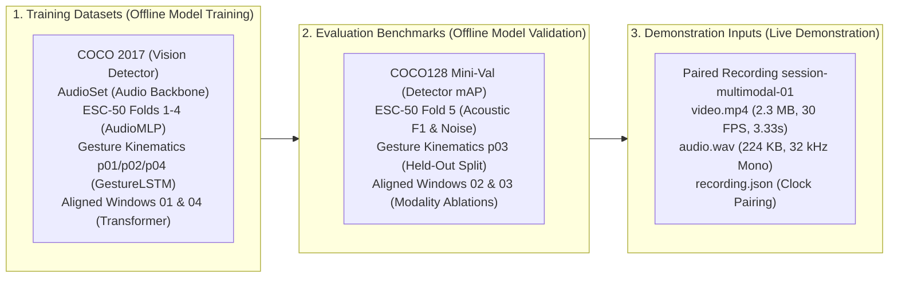

# AI AINAK — Dataset Acquisition and Preparation Guide

## 1. Overview and Modality Standards

AI AINAK operates across three synchronized perception modalities and a Transformer-based fusion network:
1. **Vision**: Object detection and tracking via Ultralytics YOLOv8n, monocular depth proxy, and looming acceleration.
2. **Audio**: Environmental audio recognition via AudioSet-pretrained PANNs CNN14 backbone and fine-tuned AudioMLP classifier.
3. **Gesture**: Bodily pose landmark extraction via Google MediaPipe Tasks API (Lite model) and temporal sequence classification via a 2-layer GestureLSTM.
4. **Multimodal Fusion**: Transformer-based fusion aligning timestamped vectors (`[time, 128]` for vision, `[time, 2048]` for audio, `[time, 128]` for gesture) with boolean availability masks.

---

## 2. Dataset Roles & Categorization

To maintain strict scientific and engineering clarity, AI AINAK datasets are partitioned into three distinct operational tiers:



### 2.1 Training Datasets (Offline Model Training)
Used solely during training to produce the finalized checkpoints. These large raw datasets (~20+ GB) are **not** downloaded during demonstration notebook execution:
- **Vision**: Microsoft COCO 2017 (`train2017`, ~118k images, CC BY 4.0).
- **Audio Backbone**: Google AudioSet (2M+ 10-second YouTube clips, 527 sound classes).
- **Audio Downstream**: ESC-50 Environmental Sound Classification (Folds 1–4, 1,600 5-second audio clips, CC BY-NC 3.0). Precomputed embeddings cached in `artifacts/audio/esc50_embeddings_cnn14.npz`.
- **Gesture Sequence**: AI AINAK Consented Kinematic Recordings (Subjects `subject_p01`, `subject_p02`, `subject_p04`, 96 sequences, 24 frames × 132 features).
- **Transformer Fusion**: `datasets/recordings/aligned_manifest.jsonl` (Sessions 01 and 04, 12 paired temporal windows).

### 2.2 Evaluation Datasets (Held-Out Benchmarking)
Held-out partitions used strictly for quantitative validation, noise robustness, and ablation studies:
- **Vision**: COCO128 validation mini-split (128 images, CC BY 4.0). Verification result: `mAP@0.5 = 0.6052`, `mAP@0.5:0.95 = 0.4468` (reported in `reports/vision-coco128-val.json`).
- **Audio**: ESC-50 Fold 5 (400 held-out clips). Verification result: **89.75% accuracy, 89.59% Macro-F1** (reported in `reports/audio-downstream-eval.json`). Noise robustness verified across clean, +20 dB SNR, +10 dB SNR, and digital silence.
- **Gesture**: AI AINAK Subject `subject_p03` (32 held-out sequences from an independent subject). Verification result: **100.0% accuracy, 1.0000 Macro-F1** (reported in `artifacts/gesture/gesture_lstm.metrics.json`).
- **Transformer Fusion**: Sessions 02 and 03 (12 paired windows). Evaluated across all 7 modality combinations (`reports/fusion-ablations.json`).

### 2.3 Demonstration Inputs (Live Colab / Local Replay)
Compact, synchronized multimodal media (~2.5 MB) required to execute the demonstration notebooks:
- **`session-multimodal-01/video.mp4`**: 2.30 MB, 100 frames, 30.0 FPS, 3.33s duration.
- **`session-multimodal-01/audio.wav`**: 224 KB, 32,000 Hz, 112,000 samples, monaural PCM.
- **`session-multimodal-01/recording.json`**: Verified session clock metadata asserting synchronization:
  - `video_offset_seconds: 0.0`
  - `audio_offset_seconds: 0.0`
  - `pairing_assertion: "source video and audio paired with verified timestamps"`

---

## 3. Asset Manifest, Checksums & Official Download Sources

| Asset Name | Target Directory | File Size | Checksum / Identifier | Official Public Source / Acquisition |
| :--- | :--- | :--- | :--- | :--- |
| `yolov8n.pt` | `checkpoints/` | 6.55 MB | SHA-256: `f59b3d833e2f...` | [Ultralytics Release Assets](https://github.com/ultralytics/assets/releases/download/v8.2.0/yolov8n.pt) *(Auto-downloaded)* |
| `Cnn14_mAP=0.431.pth` | `checkpoints/` | 327.43 MB | MD5: `541141fa2ee191...` | [Zenodo Record 3987831](https://zenodo.org/record/3987831/files/Cnn14_mAP%3D0.431.pth) *(Auto-downloaded)* |
| `downstream_mlp.pt` | `checkpoints/` | 2.17 MB | SHA-256: `48b11fb...` | AI AINAK Project Artifacts *(Included in starter bundle)* |
| `pose_landmarker_lite.task` | `checkpoints/` | 5.78 MB | SHA-256: `59929e1d1ee...` | [Google Cloud Storage](https://storage.googleapis.com/mediapipe-models/pose_landmarker/pose_landmarker_lite/float16/1/pose_landmarker_lite.task) *(Auto-downloaded)* |
| `gesture_lstm.pt` | `checkpoints/` | 1.07 MB | SHA-256: `11354e1305...` | AI AINAK Project Artifacts *(Included in starter bundle)* |
| `fusion.pt` | `checkpoints/` | 2.40 MB | SHA-256: `49aead8f88...` | AI AINAK Project Artifacts *(Included in starter bundle)* |
| `session-multimodal-01` | `datasets/recordings/` | 2.52 MB (media) | Verified media clock | AI AINAK Project Media *(Included in starter bundle)* |

---

## 4. Google Drive Layout & 1-Click Starter Bundle

For Google Colab users, the project files can be uploaded to Google Drive under `MyDrive/AINAK_Colab/`:

```text
Google Drive/
└── AINAK_Colab/
    ├── checkpoints/
    │   ├── yolov8n.pt                  # 6.55 MB (auto-downloaded)
    │   ├── Cnn14_mAP=0.431.pth         # 327.43 MB (auto-downloaded)
    │   ├── downstream_mlp.pt           # 2.17 MB
    │   ├── pose_landmarker_lite.task   # 5.78 MB (auto-downloaded)
    │   ├── gesture_lstm.pt             # 1.07 MB
    │   └── fusion.pt                   # 2.40 MB
    └── datasets/
        └── recordings/
            └── session-multimodal-01/
                ├── video.mp4           # 2.30 MB
                ├── audio.wav           # 0.22 MB
                └── recording.json      # 837 B
```

### Packaging the 1-Click Starter Bundle
To avoid uploading files individually, generate the 7.48 MB zip bundle:
```powershell
python scripts/package_colab_bundle.py
```
Upload `outputs/ainak_colab_starter_bundle.zip` into Google Drive or the Google Colab file browser. All demonstration notebooks automatically detect and extract this archive on launch.

---

## 5. Timestamp Alignment & Media Clock Verification Protocol

The AI AINAK media clock aligns multimodal observation streams using user-declared offsets relative to session time $t=0.0\,\text{s}$:
- **Video Clock**: Frame timestamp $t_v = i / \text{FPS}$, where $\text{FPS} = 30.0$.
- **Audio Clock**: Window timestamp $t_a = s / \text{SR}$, where $\text{SR} = 32,000\,\text{Hz}$ and sliding hop is 1.0s.
- **Gesture Clock**: Landmark timestamp matches video frame clock $t_g = t_v$.
- **Alignment Criterion**: Nearest-neighbor matching within maximum tolerance window $\Delta t \le 1.5\,\text{s}$. If any modality is missing, an explicit boolean mask (`[has_v, has_a, has_g]`) is supplied to the Transformer's attention padding mechanism.
