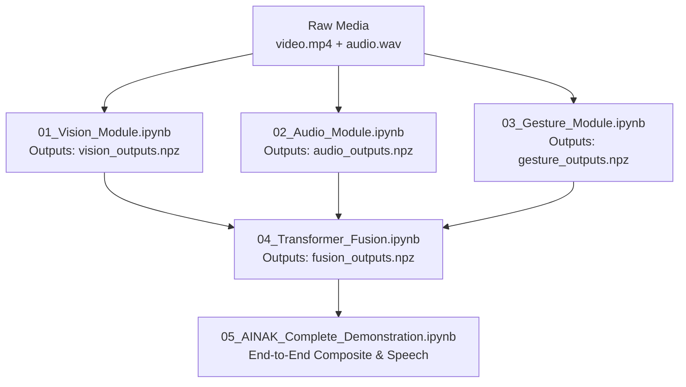

# AINAK Google Colab Multimodal Demonstration Guide

This directory contains five interactive Jupyter / Google Colab demonstration notebooks that execute the complete AI AINAK multimodal perception, fusion, decision, and speech pipeline on recorded multimodal sessions.

---

## 1. Demonstration Notebooks Overview

| Notebook | Purpose | Key Checkpoints | Primary Outputs |
| :--- | :--- | :--- | :--- |
| **`01_Vision_Module.ipynb`** | Object detection, tracking, depth proxy, and looming obstacle estimation | `yolov8n.pt` | `outputs/vision_outputs.npz` (128-D features) |
| **`02_Audio_Module.ipynb`** | Environmental sound event classification and acoustic representation | `Cnn14_mAP=0.431.pth`<br>`downstream_mlp.pt` | `outputs/audio_outputs.npz` (2048-D features) |
| **`03_Gesture_Module.ipynb`** | MediaPipe pose landmark extraction and temporal sequence classification | `pose_landmarker_lite.task`<br>`gesture_lstm.pt` | `outputs/gesture_outputs.npz` (128-D features) |
| **`04_Transformer_Fusion.ipynb`** | Multimodal temporal synchronization, cross-attention, and alert classification | `fusion.pt` | `outputs/fusion_outputs.npz` (4 alert logits, priority) |
| **`05_AINAK_Complete_Demonstration.ipynb`** | End-to-end evaluation, composite video overlay, Decision Engine, and spoken alerts | All 6 checkpoints | Spoken speech feedback, composite evaluation |

---

## 2. Google Drive Setup & Directory Layout

To run the notebooks in Google Colab with seamless persistence, create a folder named `AINAK_Colab` in the root of your Google Drive (`MyDrive/AINAK_Colab/`):

```text
Google Drive/
└── AINAK_Colab/
    ├── checkpoints/
    │   ├── yolov8n.pt                  # Vision detector
    │   ├── Cnn14_mAP=0.431.pth         # PANNs audio backbone
    │   ├── downstream_mlp.pt           # Audio classifier MLP
    │   ├── pose_landmarker_lite.task   # MediaPipe Tasks pose landmarker
    │   ├── gesture_lstm.pt             # 2-layer GestureLSTM
    │   └── fusion.pt                   # Multimodal Transformer Fusion
    ├── datasets/
    │   └── session-multimodal-01/
    │       ├── video.mp4               # Synchronized recorded video
    │       ├── audio.wav               # Synchronized recorded audio
    │       └── metadata.json           # Session metadata
    └── outputs/                        # Notebook outputs (auto-created)
        ├── vision_outputs.npz
        ├── audio_outputs.npz
        ├── gesture_outputs.npz
        └── fusion_outputs.npz
```

> **Note on Path Resolution**: All notebooks include dual-environment detection logic. If executed inside Google Colab (`'google.colab' in sys.modules`), they automatically mount Google Drive at `/content/drive` and resolve paths to `/content/drive/MyDrive/AINAK_Colab/`. If executed locally in VS Code or Jupyter, they automatically resolve paths relative to the repository root.

---

## 3. Recommended Execution Sequence

Run the notebooks sequentially for proper dependency resolution:



1. **`01_Vision_Module.ipynb`**:
   - Ingests `video.mp4`.
   - Runs YOLOv8n object detection and calculates bounding box growth rates ($dA/dt$) for looming obstacles.
   - Saves `vision_outputs.npz` (N frames, 128-D vector per frame).

2. **`02_Audio_Module.ipynb`**:
   - Ingests `audio.wav`.
   - Extracts 2,048-D acoustic bottleneck embeddings via PANNs CNN14.
   - Classifies ambient sounds via AudioMLP across 50 ESC-50 classes.
   - Saves `audio_outputs.npz` (M windows, 2048-D vector per window).

3. **`03_Gesture_Module.ipynb`**:
   - Ingests `video.mp4`.
   - Extracts 33 normalized body keypoints via MediaPipe Tasks Pose Landmarker.
   - Buffers 24 frames of normalized coordinates and runs the 2-layer unidirectional GestureLSTM.
   - Saves `gesture_outputs.npz` (K frames, 128-D vector per frame).

4. **`04_Transformer_Fusion.ipynb`**:
   - Loads the 3 `.npz` feature files from Steps 1–3.
   - Synchronizes timestamps using nearest-neighbor alignment.
   - Runs the trained 2-layer Transformer Fusion network (`fusion.pt`).
   - Generates 4 alert logits (`none`, `informational`, `caution`, `urgent`), priority scores, and self-attention weights.
   - Demonstrates robustness against missing modalities using zero-mask ablation.
   - Saves `fusion_outputs.npz`.

5. **`05_AINAK_Complete_Demonstration.ipynb`**:
   - End-to-end holistic demonstration.
   - Visualizes synchronised detections, audio events, gestures, and Transformer alert confidence over time.
   - Executes the Decision Engine rule-based prioritization.
   - Generates audio/speech alert announcements.

---

## 4. Local Execution (Without Colab)

To run the notebooks locally on Windows/Linux:

1. Activate the Python virtual environment:
   ```powershell
   .venv\Scripts\Activate.ps1
   ```
2. Start Jupyter Notebook or open the `.ipynb` files in VS Code:
   ```powershell
   jupyter lab notebooks/
   ```
3. Run cells top-to-bottom. The path detection cell will automatically detect the local workspace and locate checkpoints in `artifacts/` and recordings in `datasets/recordings/`.

---

## 5. Troubleshooting & FAQ

- **GPU vs CPU Execution**: All models default to CUDA if available (`torch.cuda.is_available()`) and fall back to CPU seamlessly. In Google Colab, select **Runtime > Change runtime type > T4 GPU** for accelerated execution.
- **MediaPipe on Colab**: MediaPipe 0.10.x uses the Tasks API. The notebooks download or locate `pose_landmarker_lite.task` directly without relying on deprecated solutions.
- **Audio Sample Rate**: The audio module expects 16 kHz or 44.1 kHz WAV files; `torchaudio` or `scipy.io.wavfile` automatically normalizes input waveforms to 32 kHz / 16 kHz as expected by PANNs CNN14.
