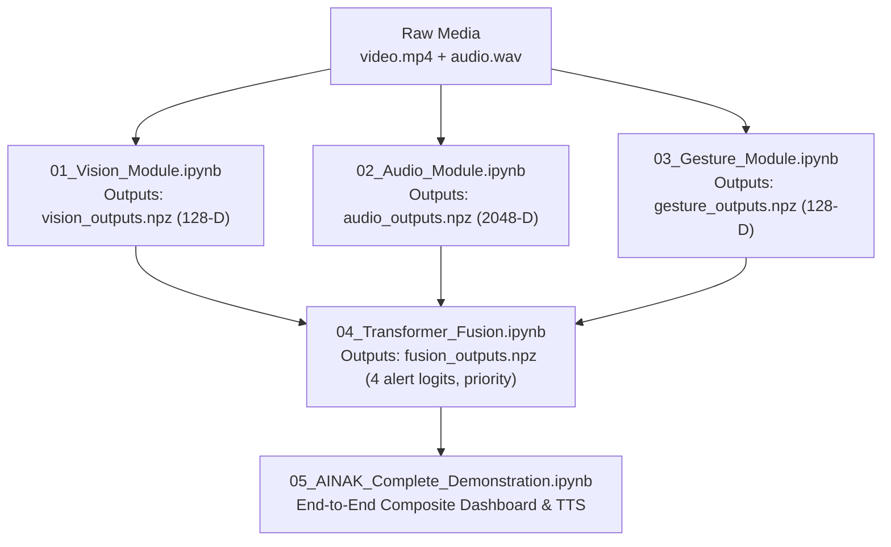

# AI AINAK — Google Colab Multimodal Demonstration & Dataset Guide

This directory contains five interactive Jupyter / Google Colab demonstration notebooks that execute the complete AI AINAK multimodal perception, fusion, decision, and speech pipeline on real recorded multimodal sessions.

---

## 1. Dataset Taxonomy & Modality Mapping

To guarantee scientific reproducibility and clarify data usage, every dataset across the AI AINAK pipeline is categorized into one of three roles:

| Modality Branch | Model | Training Dataset | Evaluation Benchmark | Demonstration Input |
| :--- | :--- | :--- | :--- | :--- |
| **Branch 1: Vision** | Ultralytics YOLOv8n (`yolov8n.pt`) | **Microsoft COCO 2017** (`train2017`, ~118k images, CC BY 4.0). Pre-trained detector weights. *Omitted from demo download to avoid 20+ GB bandwidth.* | **COCO128** (`coco128`, 128 images, CC BY 4.0). Offline detector benchmark (`mAP@0.5 = 0.6052`, reported in `reports/vision-coco128-val.json`). | **Paired Session `session-multimodal-01/video.mp4`** (2.30 MB, 100 frames @ 30.0 FPS, 3.33s duration). Real corridor walking obstacle video. |
| **Branch 2: Audio** | PANNs CNN14 Backbone (`Cnn14_mAP=0.431.pth`) + PyTorch AudioMLP (`downstream_mlp.pt`) | **Google AudioSet** (2M+ 10s clips, 527 classes) for CNN14 + **ESC-50 Folds 1–4** (1,600 5-second environmental recordings, CC BY-NC 3.0) for AudioMLP. Embeddings cached in `artifacts/audio/esc50_embeddings_cnn14.npz`. | **ESC-50 Held-Out Fold 5** (400 clips). AudioMLP achieves **89.75% accuracy and 89.59% Macro-F1** (reported in `reports/audio-downstream-eval.json`). Noise robustness tested across clean, +20 dB SNR, +10 dB SNR, and digital silence. | **Paired Session `session-multimodal-01/audio.wav`** (224 KB, 32 kHz monaural PCM, 112,000 samples, 3.50s duration). Real walking corridor ambient sound. |
| **Branch 3: Gesture** | MediaPipe Pose Landmarker (`pose_landmarker_lite.task`) + 2-layer GestureLSTM (`gesture_lstm.pt`) | **Google BlazePose 3D Dataset** for Pose Landmarker + **AI AINAK Kinematic Dataset (Subjects p01, p02, p04)** (96 sequences, 24 frames × 132 features). | **AI AINAK Subject `subject_p03` Held-Out Split** (32 sequences). GestureLSTM achieves **100.0% accuracy and 1.0000 Macro-F1** (reported in `artifacts/gesture/gesture_lstm.metrics.json`). | **Paired Session `session-multimodal-01/video.mp4`** (2.30 MB). Real video containing natural bodily gestures. |
| **Branch 4: Fusion** | Multimodal Sensor Fusion Transformer (`fusion.pt`) | **AI AINAK Aligned Session Manifest (Sessions 01 & 04)** (`datasets/recordings/aligned_manifest.jsonl`, 12 paired windows). | **Validation Session 02 & Test Session 03** (12 paired windows). Ablation benchmark across all 7 modality combinations and late-fusion baseline (reported in `reports/fusion-ablations.json`). | **Serialized Branch Outputs** (`outputs/vision_outputs.npz`, `outputs/audio_outputs.npz`, `outputs/gesture_outputs.npz`) or direct session fallback (`aligned.jsonl`). |
| **Integrated Demo** | Complete End-to-End System | All 6 trained model checkpoints combined. | End-to-end evaluation & decision calibration across all urgency bands. | **Paired Session `session-multimodal-01`** (`video.mp4` + `audio.wav` + `recording.json`). Synchronized origin ($t=0.0\,\text{s}$). |

---

## 2. Checkpoints & Asset Acquisition Guide

### A. Public Model Checkpoints (Auto-Downloaded by Notebooks)
The demonstration notebooks contain automatic download cells that fetch public weights directly from official sources if not found locally:

1. **YOLOv8n Object Detector (`yolov8n.pt`, 6.55 MB)**:
   - Direct URL: `https://github.com/ultralytics/assets/releases/download/v8.2.0/yolov8n.pt`
   - Target Location: `checkpoints/yolov8n.pt` or `artifacts/vision/yolov8n.pt`
2. **PANNs CNN14 Acoustic Backbone (`Cnn14_mAP=0.431.pth`, 327.43 MB)**:
   - Direct URL: `https://zenodo.org/record/3987831/files/Cnn14_mAP%3D0.431.pth`
   - Target Location: `checkpoints/Cnn14_mAP=0.431.pth` or `artifacts/audio/Cnn14_mAP=0.431.pth`
3. **MediaPipe Pose Landmarker Lite (`pose_landmarker_lite.task`, 5.78 MB)**:
   - Direct URL: `https://storage.googleapis.com/mediapipe-models/pose_landmarker/pose_landmarker_lite/float16/1/pose_landmarker_lite.task`
   - Target Location: `checkpoints/pose_landmarker_lite.task` or `artifacts/gesture/pose_landmarker_lite.task`

### B. Project-Trained Checkpoints & Demonstration Session Media
The project-specific trained checkpoints and demonstration recording files total **less than 8 MB**:
- `checkpoints/downstream_mlp.pt` (2.17 MB)
- `checkpoints/gesture_lstm.pt` (1.07 MB)
- `checkpoints/fusion.pt` (2.40 MB)
- `datasets/recordings/session-multimodal-01/video.mp4` (2.30 MB)
- `datasets/recordings/session-multimodal-01/audio.wav` (0.22 MB)
- `datasets/recordings/session-multimodal-01/recording.json` (837 B)

#### Quick Setup: One-Click Starter Bundle (7.48 MB)
To set up Google Drive or a fresh Google Colab session in one step:
1. Generate the bundle locally by running:
   ```powershell
   python scripts/package_colab_bundle.py
   ```
2. Upload `outputs/ainak_colab_starter_bundle.zip` (7.48 MB) to your Google Drive (`MyDrive/AINAK_Colab/`) or directly into the Google Colab file manager.
3. The notebooks automatically detect and unpack `ainak_colab_starter_bundle.zip` on startup!

---

## 3. Google Drive Setup & Directory Layout

To persist outputs across Google Colab sessions, create a folder named `AINAK_Colab` in the root of your Google Drive (`MyDrive/AINAK_Colab/`):

```text
Google Drive/
└── AINAK_Colab/
    ├── checkpoints/
    │   ├── yolov8n.pt                  # 6.55 MB (auto-downloaded)
    │   ├── Cnn14_mAP=0.431.pth         # 327.43 MB (auto-downloaded)
    │   ├── downstream_mlp.pt           # 2.17 MB (from starter bundle)
    │   ├── pose_landmarker_lite.task   # 5.78 MB (auto-downloaded)
    │   ├── gesture_lstm.pt             # 1.07 MB (from starter bundle)
    │   └── fusion.pt                   # 2.40 MB (from starter bundle)
    ├── datasets/
    │   └── recordings/
    │       └── session-multimodal-01/
    │           ├── video.mp4           # 2.30 MB (from starter bundle)
    │           ├── audio.wav           # 0.22 MB (from starter bundle)
    │           ├── recording.json      # 837 B (clock assertions)
    │           └── aligned.jsonl       # 89 KB (reference features)
    └── outputs/                        # Generated by notebooks
        ├── vision_outputs.npz
        ├── audio_outputs.npz
        ├── gesture_outputs.npz
        └── fusion_outputs.npz
```

> **Automatic Path Resolution**: Every notebook features intelligent dual-environment path resolution. If running in Google Colab, it mounts `/content/drive` and looks in `MyDrive/AINAK_Colab/` or `/content/`. If running locally in VS Code or Jupyter, it resolves relative to the local repository root.

---

## 4. Notebook Execution Sequence



1. **`01_Vision_Module.ipynb`**:
   - Downloads `yolov8n.pt` if missing.
   - Runs pre-flight audit validating `yolov8n.pt` and `session-multimodal-01/video.mp4`.
   - Ingests `video.mp4`, performs YOLOv8n object detection, ByteTrack tracking, relative depth, and looming hazard calculation ($dA/dt$).
   - Exports `outputs/vision_outputs.npz` (30 frames × 128-D).

2. **`02_Audio_Module.ipynb`**:
   - Downloads `Cnn14_mAP=0.431.pth` from Zenodo if missing.
   - Runs pre-flight audit validating `Cnn14_mAP=0.431.pth`, `downstream_mlp.pt`, and `session-multimodal-01/audio.wav`.
   - Ingests `audio.wav` at 32 kHz, applies RMS silence rejection (`RMS < 1e-5`), extracts 2,048-D CNN14 bottleneck embeddings, and classifies sound classes via AudioMLP across 50 ESC-50 classes.
   - Exports `outputs/audio_outputs.npz` (2 windows × 2,048-D).

3. **`03_Gesture_Module.ipynb`**:
   - Downloads `pose_landmarker_lite.task` from Google Cloud Storage if missing.
   - Runs pre-flight audit validating `pose_landmarker_lite.task`, `gesture_lstm.pt`, and `session-multimodal-01/video.mp4`.
   - Ingests `video.mp4`, extracts 33 body landmarks via MediaPipe Tasks API, applies torso-relative normalization (132-D), maintains a 24-frame temporal buffer, and runs 2-layer GestureLSTM.
   - Exports `outputs/gesture_outputs.npz` (30 frames × 128-D).

4. **`04_Transformer_Fusion.ipynb`**:
   - Runs pre-flight audit validating `fusion.pt` and upstream feature matrices (`outputs/*.npz` or session fallback `aligned.jsonl`).
   - Synchronizes timestamps using nearest-neighbor sliding window alignment ($\Delta t \le 1.5\,\text{s}$).
   - Executes the trained 2-layer 4-head Transformer encoder (`fusion.pt`).
   - Generates 4 alert category logits (`none`, `informational`, `caution`, `urgent`), continuous hazard priority ($0.0$ to $1.0$), confidence ($0.0$ to $1.0$), and self-attention modality contributions.
   - Evaluates missing-modality robustness across all 7 combination ablations.
   - Exports `outputs/fusion_outputs.npz`.

5. **`05_AINAK_Complete_Demonstration.ipynb`**:
   - Flagship evaluator-facing presentation notebook.
   - Runs complete pre-flight system audit checking all 6 model checkpoints and demonstration media.
   - Executes the complete multimodal perception, fusion, and decision workflow end-to-end.
   - Evaluates Decision Engine urgency bands (`immediate_attention`, `caution`, `gesture_feedback`, `informational`, `uncertain`).
   - Renders synchronized composite dashboard and generates assistive spoken audio alert announcements.

---

## 5. Local Execution Instructions

To execute the notebooks locally on Windows or Linux:
1. Activate the Python virtual environment:
   ```powershell
   .venv\Scripts\Activate.ps1
   ```
2. Launch Jupyter Lab or VS Code Notebook Editor:
   ```powershell
   jupyter lab notebooks/
   ```
3. Run cells sequentially top-to-bottom. The dual-environment detector automatically finds local checkpoints in `artifacts/` and media in `datasets/recordings/`.

---

## 6. Pre-Flight Asset Audit Checklist

Every notebook contains an automated pre-flight integrity audit block that validates all required files before starting inference:

```text
================================================================================
  AI AINAK PRE-FLIGHT ASSET & DATASET INTEGRITY AUDIT
================================================================================
  [OK] PASSED | yolov8n.pt                   |   6.55 MB | Model Checkpoint | Trained YOLOv8n object detector
  [OK] PASSED | Cnn14_mAP=0.431.pth          | 327.43 MB | Backbone Weights | PANNs CNN14 pretrained acoustic backbone
  [OK] PASSED | downstream_mlp.pt           |   2.17 MB | Classifier Check | Trained PyTorch AudioMLP (50 classes)
  [OK] PASSED | pose_landmarker_lite.task    |   5.78 MB | Pose Landmarker  | MediaPipe Tasks 33-point pose landmarker
  [OK] PASSED | gesture_lstm.pt              |   1.07 MB | Sequence Classif | Trained 2-layer GestureLSTM (4 classes)
  [OK] PASSED | fusion.pt                    |   2.40 MB | Fusion Model     | Trained Multimodal Transformer checkpoint
  [OK] PASSED | video.mp4                    |   2.30 MB | Demo Video       | Paired session video (session-multimodal-01)
  [OK] PASSED | audio.wav                    |   0.22 MB | Demo Audio       | Paired session audio (session-multimodal-01)
  [OK] PASSED | recording.json               |   0.00 MB | Clock Metadata   | Session clock & pairing assertion
================================================================================
```
If any file is missing, the cell raises a clear descriptive error pointing to the exact download link or upload location, preventing unhandled exceptions during inference.
