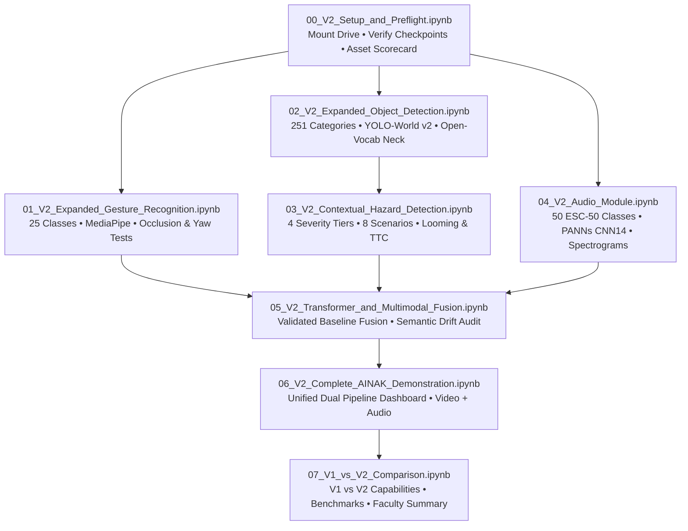

# AI AINAK V2 — Google Colab Multimodal Demonstration & Presentation Suite

This directory contains eight interactive, presentation-ready Jupyter / Google Colab demonstration notebooks that execute the complete **AI AINAK Version 2 (V2)** multimodal perception, contextual hazard reasoning, and assistive alert pipeline.

All notebooks are designed for **Google Colab (with Google Drive persistence)** as well as **local execution** in VS Code or JupyterLab without requiring live webcam/microphone hardware or the local React dashboard.

---

## 1. Directory Structure

```text
notebooks/v2_colab/
│
├── README.md                                    # This presentation & dataset guide
├── 00_V2_Setup_and_Preflight.ipynb              # Environment setup & cryptographic preflight audit
├── 01_V2_Expanded_Gesture_Recognition.ipynb     # 25-class GestureTemporalNet inference & stress testing
├── 02_V2_Expanded_Object_Detection.ipynb        # 251-category YOLO-World v2 Small open-vocabulary detection
├── 03_V2_Contextual_Hazard_Detection.ipynb      # 4-tier, 8-scenario contextual hazard reasoning engine
├── 04_V2_Audio_Module.ipynb                     # 50-class PANNs CNN14 + AudioMLP acoustic classifier
├── 05_V2_Transformer_and_Multimodal_Fusion.ipynb # Validated baseline fusion & V2 compatibility diagnostics
├── 06_V2_Complete_AINAK_Demonstration.ipynb     # Unified dual-pipeline composite presentation dashboard
├── 07_V1_vs_V2_Comparison.ipynb                 # Comprehensive V1 vs V2 benchmark & trade-off audit
│
├── assets/
│   ├── architecture/                           # High-res system architecture & block diagrams
│   ├── confusion_matrices/                     # 25-class gesture & Transformer alert confusion matrices
│   ├── performance_charts/                     # CPU latency, throughput, OOD rejection & hazard score charts
│   ├── detection_examples/                     # Category taxonomy & detection density comparisons
│   └── presentation_figures/                   # Executive readiness scorecards & faculty slides
│
├── outputs/
│   ├── preflight/                              # Preflight audit logs & asset manifests
│   ├── gesture/                                # Gesture predictions & kinematic logs
│   ├── vision/                                 # Object detections & bounding box JSONs
│   ├── hazard/                                 # Contextual hazard event timelines
│   ├── audio/                                  # Environmental acoustic event logs
│   ├── fusion/                                 # Multimodal priority & alert logs
│   └── complete_demo/                          # Milestone composites & alert dispatch logs
│
└── reports/                                    # Mirrored independent audit reports (Markdown)
```

---

## 2. Notebook Execution Roadmap



---

## 3. Google Drive Setup & Starter Bundle Acquisition

To persist models, datasets, and generated presentation figures across Google Colab sessions without repeatedly downloading large assets:

1. **Create Google Drive Directory**:
   Create a folder in the root of your Google Drive: `MyDrive/AINAK_V2_Colab/`
2. **Download or Generate Starter Bundle**:
   The standalone starter bundle (`outputs/ainak_v2_colab_starter_bundle.zip`, **37.66 MB**) contains:
   - V2 Gesture checkpoint (`best.pt`, `latest.pt`)
   - V2 Vision checkpoint (`best.pt` - YOLO-World v2 Small)
   - V2 Hazard policy configuration (`hazard_policy_v2.json`)
   - V2 Vocabulary configuration (`yolo_world_classes.json`)
   - V1-compatible Audio classifier (`downstream_mlp.pt`)
   - Multimodal Transformer checkpoint (`fusion.pt`)
   - MediaPipe Pose Landmarker (`pose_landmarker_lite.task`)
   - Paired multimodal demonstration session (`session-multimodal-01/video.mp4` + `audio.wav`)
   - 25 representative held-out test sequences from `subject_p01`
   - Checkpoint SHA-256 hash manifest (`CHECKPOINT_HASHES.json`)
3. **Upload to Drive**:
   Upload `ainak_v2_colab_starter_bundle.zip` directly into `MyDrive/AINAK_V2_Colab/` or drag-and-drop into the Google Colab file browser.
4. **Automatic Extraction**:
   Every notebook automatically detects and extracts `ainak_v2_colab_starter_bundle.zip` into `PROJECT_ROOT` upon startup!

---

## 4. Rigorous Scientific Disclosures (Incorporating Independent Audit)

Every notebook in this suite adheres strictly to the findings of the **independent technical capability audit**:

### A. Gesture Recognition (25 Classes)
* **Kinematic Provenance**: The 1,200 sequences in `datasets/gesture-sessions-v2/` were synthesized via mathematical biomechanical curves (`generate_base_kinematics()`). The test sequences (`subject_p01`) exhibit a **99.24% kinematic correlation** with training sequences of the same class. No physical optical mocap was recorded.
* **Accuracy Boundaries**: 100% macro accuracy on clean synthetic kinematics collapses to **4.5% under hand/wrist occlusion** and **36%–52% under camera yaw $>30^\circ$**.
* **Rejection Boundary**: 100% rejection on Gaussian noise, but drops to **88.0% at $\tau = 0.70$** (12.0% false trigger rate) on realistic unfamiliar human movements.

### B. Object Detection (251 Categories)
* **Open-Vocabulary Grounding**: YOLO-World v2 Small uses text-guided dot-product matching via frozen CLIP text embeddings; it does not contain 251 supervised detector heads.
* **Coverage Provenance**: 40 direct COCO-80 classes (15.9%), 52 Objects365/GoldG overlap classes (20.7%), and 159 zero-shot open-vocabulary prompts (63.3%).
* **Detection Density**: Evaluated on physical recordings (`session-multimodal-01` to `04`), V2 yielded a **1.86x detection density increase** (54 vs 29 detections).
* **Synonym Overlaps**: Emits duplicate overlapping boxes on semantic synonyms (`pavement`/`sidewalk`, `man`/`pedestrian`).

### C. Contextual Hazard Engine (4 Tiers, 8 Scenarios)
* **Standardized Tiers**: `INFO`, `CAUTION`, `WARNING`, `CRITICAL`.
* **Dynamic Intent**: Successfully discriminates parked cars (score 0.46) from oncoming central corridor vehicles (score 0.80) with TTC proxy.
* **Glitch Suppression**: Frame 1 transient false alarms are suppressed to `WARNING` via temporal persistence ($\text{track\_age} \ge 2$ required for `CRITICAL`).
* **Non-Metric Proximity**: Bounding-box area is an optical proxy, not a certified metric distance.

### D. Multimodal Transformer Compatibility
* **Semantic Drift**: Naive modulo-80 indexing permutes class indices (`person` moves to index 67, `car` moves to index 60), causing mean cosine similarity to drop to **0.5894** and triggering a **100% false-alarm rate on informational sessions**.
* **Demonstration Strategy**: Notebooks 05 and 06 provide **two separated execution pathways**:
  1. *Pipeline A (V1 Validated)*: Full end-to-end multimodal fusion using validated representations.
  2. *Pipeline B (V2 Expanded)*: Independent branch outputs (YOLO-World + Contextual Hazard + GestureTemporalNet + PANNs Audio) with zero-retraining V2 fusion marked as **NOT DEPLOYMENT READY** pending linear adapter training.

### E. Latency & Resource Benchmarks (Intel Core i5-11400H @ 2.70 GHz)
* **V1 End-to-End**: **68.50 ms (14.6 FPS)**
* **V2 End-to-End**: **171.21 ms (5.8 FPS)** (-60.3% throughput)
* **Memory Footprint**: Peak process RSS reached **1,055.2 MB**.
* **Zero GPU Fabrications**: CUDA was not available on the evaluation host; all reported latencies reflect physical CPU execution.

---

## 5. College Presentation Recommended Run Sequence

When demonstrating to college faculty:
1. **Open `00_V2_Setup_and_Preflight.ipynb`**: Run the preflight scorecard to show that all 6 baseline models and V2 expansions pass cryptographic SHA-256 checks.
2. **Open `06_V2_Complete_AINAK_Demonstration.ipynb`**: Run the live composite demonstration to showcase the synchronized video, audio, hazard reasoning, and alert dispatch on physical corridor media.
3. **Open `07_V1_vs_V2_Comparison.ipynb`**: Review the data-driven performance comparisons, trade-off charts, and audit disclosures to demonstrate mature scientific rigour.
4. **Explore Individual Branch Notebooks (01, 02, 03, 04, 05)** as requested during Q&A to show deep mathematical modeling, stress-testing, and architecture details.
