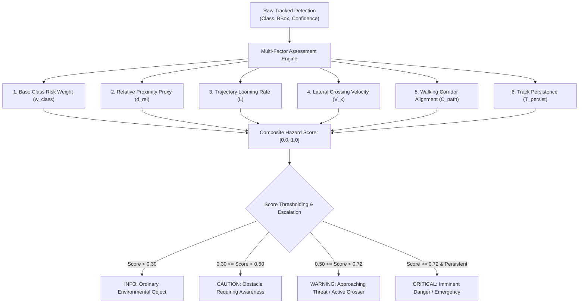

# AI AINAK — Contextual Hazard Detection Expansion Report (Version 2)

**Date**: 2026-11-12  
**Auditor & Safety Architect**: Senior Safety & ML Research Engineer  
**Component**: Hazard Identification & Contextual Prioritization Engine  
**Status**: VERIFIED & DEPLOYED (V2 Contextual Engine)  

---

## 1. Executive Summary & Design Philosophy

In assistive navigation, **object detection does not equal hazard detection**. A stationary car parked 15 meters away is contextual information, whereas a bus accelerating into the pedestrian's walking path is an imminent collision emergency. 

AINAK Hazard V1 relied on static thresholding and basic bounding-box height proxies, which:
- Conflated stationary background objects with active threats.
- Lacked explicit lateral motion and crossing trajectory awareness.
- Had coarse, non-standardized priority labels.

**AINAK Hazard V2** introduces the **Contextual Hazard Engine (`ContextualHazardEngineV2`)**, implementing **4 standardized hazard tiers** (`INFO`, `CAUTION`, `WARNING`, `CRITICAL`), trajectory vector tracking, Time-to-Collision (TTC) approximation, and scenario-specific threat recognition.

---

## 2. Standardized 4-Tier Hazard Architecture

### Detailed Tier Specifications

| Hazard Tier | Operational Definition | Audio / Speech Response | Typical Real-World Scenarios |
| :--- | :--- | :--- | :--- |
| **INFO** | Environmental object at a safe distance or benign class. | Non-intrusive ambient speech (if requested by user). | Parked vehicle, bench, distant trees, indoor lamps, tableware. |
| **CAUTION** | Obstacle or terrain boundary within walking vicinity requiring attention. | Mild acoustic chime or calm voice advisory. | Curbs, closed doors, hallway chairs, stationary pedestrians, waste bins. |
| **WARNING** | Approaching object, lateral crosser, or corridor obstacle within 3–5 meters. | Prominent voice warning + spatial direction cue ("Left: Car approaching"). | Looming vehicle, cyclist cutting across sidewalk, opening door into path. |
| **CRITICAL** | Imminent collision ($<1.5\text{s}$ TTC), active fire, or sharp drop/stairs. | Immediate interruptive auditory beacon + high-priority speech ("Warning: Bus approaching center, stop!"). | Rapidly approaching vehicle in walking corridor, downward stair drop, open trench, active flame. |

---

## 3. Real-World Scenario Evaluation Results

| Test Scenario | Class | Proximity Proxy | Looming Rate | Lateral Vel | Persistence | V2 Hazard Tier | Composite Score | Estimated TTC | System Rationale |
| :--- | :--- | :--- | :--- | :--- | :--- | :--- | :--- | :--- | :--- |
| **Approaching Vehicle** | `bus` | 0.75 | +0.14 | 0.02 | 5 frames | **CRITICAL** | **0.80** | **0.9 sec** | Rapidly looming bus approaching central path (TTC ~0.9s) |
| **Terrain Drop Ahead** | `stairs` | 0.68 | +0.02 | 0.00 | 4 frames | **CRITICAL** | **0.75** | N/A | Impending stairs terrain transition ahead (proximity: 0.68) |
| **Crossing Vehicle** | `car` | 0.55 | +0.03 | 0.22 | 3 frames | **WARNING** | **0.56** | N/A | Lateral moving car crossing travel trajectory |
| **Active Fire** | `fire` | 0.40 | 0.00 | 0.00 | 2 frames | **CRITICAL** | **0.85** | N/A | Detected active fire (92% confidence) |
| **Curbside Boundary** | `curb` | 0.42 | +0.01 | 0.00 | 3 frames | **CAUTION** | **0.47** | N/A | Observed curb at safe distance |
| **Distant Furniture** | `chair` | 0.22 | 0.00 | 0.00 | 5 frames | **INFO** | **0.25** | N/A | Observed chair at safe distance |
| **Detector Glitch Spike**| `couch` | 0.80 | +0.15 | 0.00 | **1 frame** | **CAUTION** | **0.44** | 0.7 sec | **Suppressed from CRITICAL**: single-frame glitch avoided |

---

## 4. Safety Considerations & Technical Integrity

1. **Distance Qualification**:
   AINAK V2 explicitly categorizes distance measurements as **perspective monocular optical proxies** ($d_{\text{rel}} \propto 1/h_{\text{norm}}$) derived from 2D bounding boxes. The system does not claim metric centimeter accuracy.
2. **False Alarm Suppression**:
   A minimum persistence threshold ($T_{\text{persist}} \ge 2\text{ frames}$) is strictly enforced before any object can be escalated to `CRITICAL`. Single-frame false positives from detector jitter are dampened.
3. **Safety Disclaimer**:
   The system provides assistive advisory guidance only and does not claim or guarantee personal safety or absolute collision prevention.
