# AI AINAK — Capability Expansion (Version 2) Technical Implementation Plan

**Date**: 2026-11-12  
**Auditor & Architect**: Senior ML Research Engineer, Computer Vision Specialist & Deep Learning Auditor  
**Scope**: Multimodal Gesture (4 -> 25 classes), Object Detection (80 -> 220+ categories), Contextual Hazard Scoring (4 levels), and Reversible Model Registry  

---

## 1. Executive Summary & Core Mandate

The primary objective of AINAK Version 2 (V2) is to dramatically expand real-world utility for visually impaired users by:
1. Expanding kinematic gesture recognition from 4 classes to **25 real-world communication and emergency gestures**.
2. Expanding object detection from 80 COCO categories to **220+ accessibility, navigation, and environmental danger categories** via YOLO-World open-vocabulary grounding.
3. Upgrading heuristic hazard scoring into a **4-tier Contextual Hazard Engine** (`INFO`, `CAUTION`, `WARNING`, `CRITICAL`) with trajectory tracking and time-to-collision (TTC) estimation.
4. Preserving **100% multimodal compatibility** with the existing Multimodal Transformer and ensuring an immediate, verified one-command rollback to V1.

**CRITICAL SAFETY CONSTRAINT**: Original V1 checkpoints, architectures, configurations, and reports will NOT be overwritten, deleted, or modified. V1 remains fully functional and accessible at all times.

---

## 2. File Impact & Modification Inventory

### Untouched Baseline Files (Guaranteed Immutable)
- All V1 model checkpoints:
  - `artifacts/vision/yolov8n.pt`
  - `artifacts/audio/Cnn14_mAP=0.431.pth`
  - `artifacts/audio/downstream_mlp.pt`
  - `artifacts/gesture/pose_landmarker_lite.task`
  - `artifacts/gesture/gesture_lstm.pt`
  - `artifacts/fusion/fusion.pt`
- All original training configurations in `configs/*.yaml` (`alerts.yaml`, `audio.yaml`, `fusion.yaml`, `gesture.yaml`, `vision.yaml`)
- All original reports in `reports/*.json` and `reports/*.md`
- All recorded demonstration sessions in `datasets/recordings/**` and `datasets/ESC-50/**`
- All Colab notebooks in `notebooks/**`

### New Files Created for V2
- Backups and Version Control:
  - `backups/v1_original/**` (full backup of checkpoints, configs, reports, and SHA-256 manifest)
  - `configs/version_config.yaml` (active version selector)
  - `configs/model_registry.yaml` (complete model registry)
  - `scripts/switch_model_version.py` (one-command switch and rollback tool)
- V2 Artifacts:
  - `artifacts/v2/gesture/best.pt`, `artifacts/v2/gesture/latest.pt`, `artifacts/v2/gesture/gesture_temporal.metrics.json`
  - `artifacts/v2/vision/best.pt`, `artifacts/v2/vision/yolo_world_classes.json`
  - `artifacts/v2/hazard/hazard_policy_v2.json`
- V2 Code Modules:
  - `ainak/models/gesture/v2_gesture.py` (25-class temporal sequence model)
  - `ainak/models/vision/v2_detector.py` (220+ class open-vocabulary detector)
  - `ainak/models/vision/v2_hazard_engine.py` (4-level contextual hazard engine)
  - `ainak/models/factory.py` (dynamic version-aware loader for V1/V2)
- V2 Evaluation & Training Scripts:
  - `scripts/train_gesture_v2.py`
  - `scripts/evaluate_v2_models.py`
  - `tests/unit/test_v2_expansion.py`
- Reports in `reports/capability_expansion/`:
  - `GESTURE_EXPANSION_REPORT.md`
  - `OBJECT_DETECTION_EXPANSION_REPORT.md`
  - `HAZARD_DETECTION_REPORT.md`
  - `MODEL_COMPARISON_V1_V2.md`
  - `DATASET_PROVENANCE.md`
  - `CHECKPOINT_AND_ROLLBACK_REPORT.md`
  - `FINAL_VALIDATION_REPORT.md`

### Minimally Modified Files
- `ainak/config.py`: Add optional resolution of active model versions from `version_config.yaml` while strictly retaining default V1 paths when unmodified.

---

## 3. Phase-by-Phase Technical Specifications

```mermaid
flowchart TD
    subgraph Phase0["Phase 0: Backup & Version Registry"]
        A["Record SHA-256 Baseline"] --> B["Create backups/v1_original/"]
        B --> C["Deploy configs/version_config.yaml"]
        C --> D["Deploy switch_model_version.py"]
    end

    subgraph Phase1["Phase 1: Gesture Expansion (25 Classes)"]
        D --> E["Curate Kinematic Dataset (25 classes, 4 splits)"]
        E --> F["Train GestureTemporalNet (BiLSTM + LayerNorm)"]
        F --> G["Evaluate Accuracy, F1, & Unknown Rejection"]
    end

    subgraph Phase2["Phase 2: Vision Expansion (220+ Classes)"]
        G --> H["Deploy YOLO-World v2 Small Open Vocabulary"]
        H --> I["Bind 220+ Accessibility & Danger Categories"]
        I --> J["Benchmark Precision, Recall, mAP & Latency"]
    end

    subgraph Phase3["Phase 3: Contextual Hazard Engine"]
        J --> K["Design 4 Hazard Tiers: INFO, CAUTION, WARNING, CRITICAL"]
        K --> L["Implement Trajectory Looming & TTC Calculation"]
        L --> M["Validate False-Alarm Suppression"]
    end

    subgraph Phase4["Phase 4: Multimodal Transformer Compatibility"]
        M --> N["Ensure 128-D Feature Embedding Invariance"]
        N --> O["Verify 7-Modality Ablations on Session Media"]
    end

    subgraph Phase5["Phase 5: Real-World Testing & Reports"]
        O --> P["Run End-to-End Multimodal Replay Suite"]
        P --> Q["Verify Rollback Mechanism"]
        Q --> R["Generate 7 Expansion Reports"]
    end
```

---

## 4. Compute, Storage, and Latency Budget

| Component | Architecture / Model | Parameter Count | Disk Footprint | Expected Latency (CPU) | Expected Throughput |
| :--- | :--- | :--- | :--- | :--- | :--- |
| **Gesture V1** | GestureLSTM (4 classes) | 267,012 | 1.07 MB | ~1.40 ms | ~714 seq/s |
| **Gesture V2** | GestureTemporalNet (25 classes) | ~320,000 | ~1.30 MB | ~1.85 ms | ~540 seq/s |
| **Vision V1** | YOLOv8n (80 COCO classes) | 3,157,200 | 6.55 MB | ~38.2 ms (320x320) | ~26.2 FPS |
| **Vision V2** | YOLO-World v2 Small (220+ classes) | 24,700,000 | 24.70 MB | ~140-180 ms (CPU) | ~6.5 FPS |
| **Hazard V1** | Heuristic Scorer | Rule-based (0) | In-memory | <0.1 ms | >10,000/s |
| **Hazard V2** | Contextual Hazard Engine | State-machine (0) | In-memory | ~0.2 ms | >5,000/s |
| **Total Pipeline V1** | Full Multimodal Cycle | ~86.2M params | ~340 MB | ~81.5 ms | ~12.3 Hz |
| **Total Pipeline V2** | Full Multimodal Cycle | ~108M params | ~365 MB | ~195 ms (CPU) | ~5.1 Hz (CPU) / ~30 Hz (GPU) |

---

## 5. Execution Strategy & Next Steps

1. **Step 1 (Mandatory Check)**: Phase 0 is complete. V1 baseline SHA-256 hashes are verified, backups are generated, and `switch_model_version.py` is tested.
2. **Step 2 (Phase 1 Gesture Expansion)**: Build the 25-class kinematic sequence dataset with participant-disjoint splits, train `GestureTemporalNet`, validate 128-D embedding projection, and save checkpoints to `artifacts/v2/gesture/`.
3. **Step 3 (Phase 2 Vision Expansion)**: Build `v2_detector.py` with YOLO-World v2 Small, load 220+ target classes, benchmark on validation frames, and save weights to `artifacts/v2/vision/`.
4. **Step 4 (Phase 3 Hazard Engine)**: Build `v2_hazard_engine.py` with 4 discrete hazard levels, trajectory prediction, and TTC calculation.
5. **Step 5 (Phase 4 Multimodal Integration)**: Verify that the 128-D feature outputs feed cleanly into the existing Multimodal Transformer.
6. **Step 6 (Phase 5 & 6 Testing & Rollback)**: Run regression tests and verify reversible rollback.
7. **Step 7 (Phase 7 Reports)**: Write all 7 comprehensive markdown reports in `reports/capability_expansion/`.
